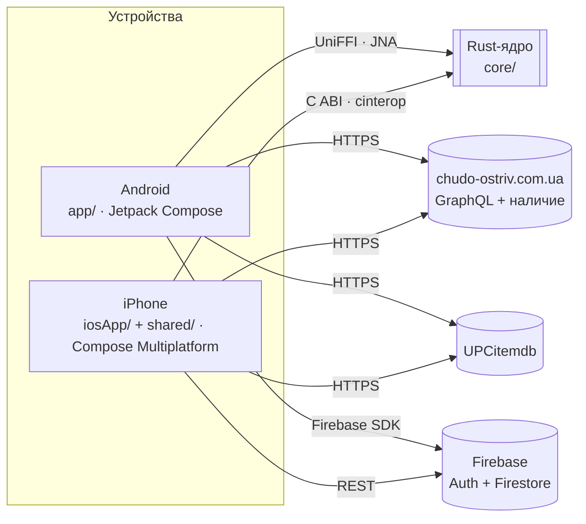
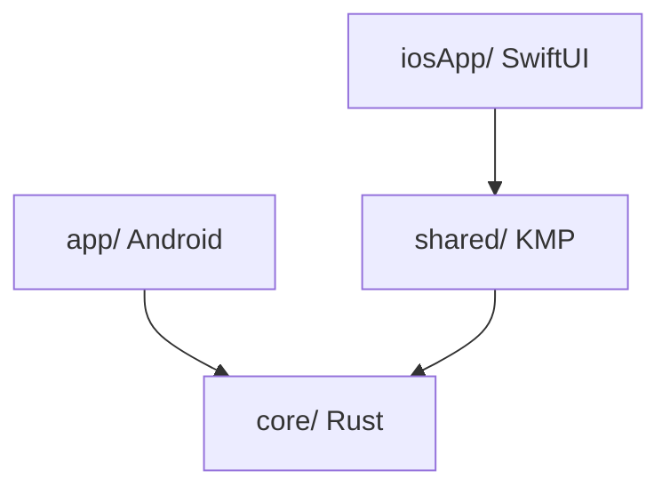
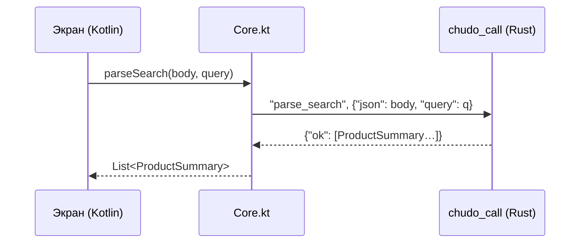
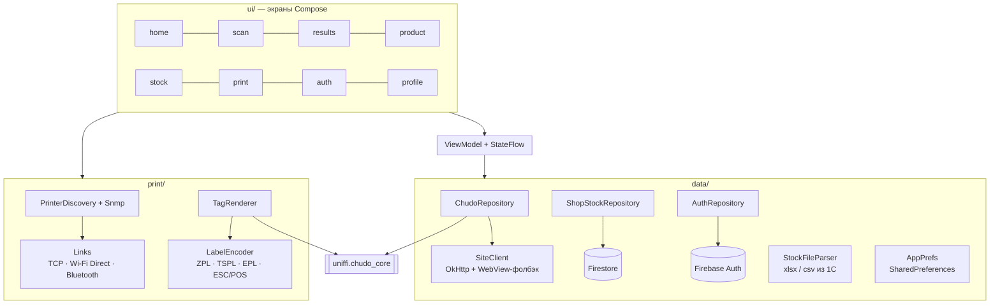
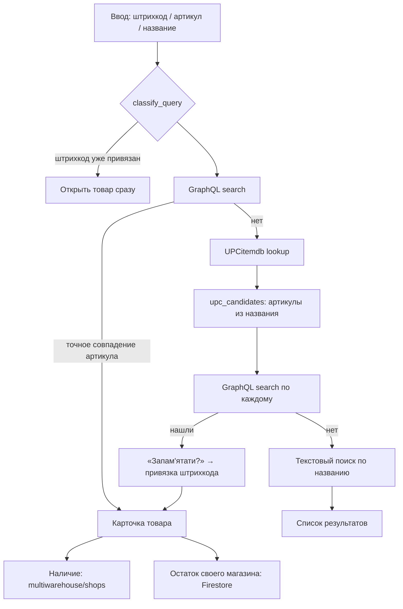
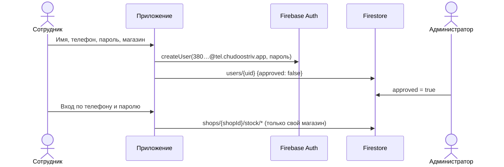
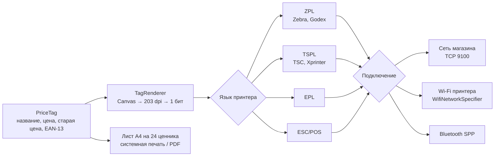
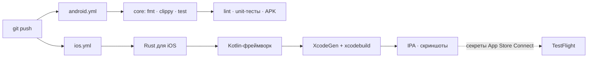

# Архитектура ЧудоСкан

Документ описывает, из чего состоит ЧудоСкан, как части связаны между собой и почему они устроены
именно так. Для установки и сборки — [README](README.md).

## Содержание

1. [Обзор](#1-обзор)
2. [Модули](#2-модули)
3. [Rust-ядро](#3-rust-ядро-core)
4. [Мост ядра в Kotlin](#4-мост-ядра-в-kotlin)
5. [Android-приложение](#5-android-приложение-app)
6. [Общий модуль и iOS](#6-общий-модуль-shared-и-ios-iosapp)
7. [Поиск товара](#7-поиск-товара)
8. [Вход и остатки (Firebase)](#8-вход-и-остатки-firebase)
9. [Печать ценников](#9-печать-ценников)
10. [Сборка и CI](#10-сборка-и-ci)
11. [Тесты](#11-тесты)
12. [Принятые решения](#12-принятые-решения)
13. [Ограничения и развитие](#13-ограничения-и-развитие)

---

## 1. Обзор

ЧудоСкан — приложение для продавцов сети «Чудо Острів». Продавец сканирует штрихкод, вводит артикул
или название и за секунду видит цену, наличие в магазинах города и остаток в своём магазине.

Три принципа:

- **Одна логика для всех платформ.** Всё, что касается данных сайта (запросы, разбор ответов,
  штрихкоды), написано один раз на Rust и одинаково работает на Android и iPhone.
- **Ядро без ввода-вывода.** Rust не ходит в сеть и не трогает файлы: строит тела запросов и разбирает
  ответы. Поэтому его легко тестировать на сохранённых ответах сайта.
- **Платформа делает только платформенное.** Камера, сеть, хранение, печать и интерфейс — на стороне
  Kotlin/Swift, там, где есть нативные API.

## 2. Модули

| Модуль | Язык | Назначение |
|---|---|---|
| [`core/`](core) | Rust | Запросы к сайту, разбор ответов, штрихкоды EAN/UPC, города, распознавание блокировок |
| [`app/`](app) | Kotlin, Jetpack Compose | Android-приложение: сканер, поиск, карточка, остатки, печать, вход |
| [`shared/`](shared) | Kotlin Multiplatform, Compose Multiplatform | Общий код и экраны для iPhone; Firebase через REST |
| [`iosApp/`](iosApp) | Swift, SwiftUI | Тонкая оболочка iOS: показывает экраны из `shared` |
| [`firestore.rules`](firestore.rules) | Firestore Rules | Кто что видит в базе |
| [`docs/`](docs) | HTML | Страница установки (GitHub Pages), скриншоты, логотип |
| [`.github/workflows/`](.github/workflows) | GitHub Actions | Сборка и проверки Android, Rust и iOS |

Зависимости направлены только внутрь: платформы зависят от ядра, ядро не знает о платформах.

## 3. Rust-ядро (`core/`)

| Файл | Что делает |
|---|---|
| `barcode.rs` | Определяет тип ввода (EAN-13, EAN-8, UPC-A, артикул, текст), проверяет контрольную цифру, рисует полосы EAN-13 для ценника |
| `graphql.rs` | Тела запросов к Magento GraphQL (через `variables`, без склейки строк) и разбор ответов; точное совпадение артикула по `external_id` |
| `shops.rs` | Разбор HTML наличия по магазинам (`available` / `not-available`) |
| `upc.rs` | Ответ UPCitemdb → вероятные артикулы из названия товара |
| `guard.rs` | Распознаёт страницу проверки Cloudflare, 403/429/503 |
| `regions.rs` | 29 городов с кодами сайта |
| `urls.rs` | Адреса сайта и UPCitemdb |
| `model.rs` | Общие типы: `ProductSummary`, `ProductDetails`, `ShopAvailability`, `Region`… |
| `ffi_c.rs` | C-интерфейс для iOS: `chudo_call(метод, JSON)` |
| `error.rs` | `CoreError` |

Функции ядра чистые: на вход строка, на выход значение или `CoreError`. В релизе — `opt-level = "z"`,
LTO и `panic = "abort"`: библиотека для arm64 весит около 1,5 МБ.

## 4. Мост ядра в Kotlin

У ядра две «двери», и у каждой своя причина:

| | Android | iOS |
|---|---|---|
| Механизм | [UniFFI](https://mozilla.github.io/uniffi-rs/) → Kotlin-обёртка (`app/src/main/java/uniffi/`) | C ABI → Kotlin/Native `cinterop` (`core/include/chudo_core.h`) |
| Библиотека | `libchudo_core.so` (cargo-ndk, 3 ABI) | `libchudo_core.a` (статическая, `aarch64-apple-ios[-sim]`) |
| Вызов | Типизированные функции и классы | Одна функция `chudo_call("method", "{json}")` → `{"ok": …}` / `{"err": …}` |
| Модели | Сгенерированы UniFFI | `@Serializable`-классы в `shared/core/Core.kt` |

JSON-мост для iOS выбран потому, что UniFFI не генерирует код для Kotlin/Native. Чтобы модели
на двух сторонах не разошлись, `CoreContractTest` прогоняет Kotlin-модели `shared` через настоящее
ядро на сохранённых ответах сайта.

## 5. Android-приложение (`app/`)

Слои — обычные для Compose-приложения, без DI-фреймворка: все зависимости создаёт `ChudoApp`
(ручной DI, один контейнер).

- **Камера:** CameraX + ML Kit Barcode. Код принимается, если совпал в двух кадрах подряд.
- **Сеть:** OkHttp. Если Cloudflare вернул страницу проверки (`detect_block`), запрос повторяется
  из невидимого WebView, у которого есть JS и cookies (`WebViewFetcher`).
- **Состояние:** `StateFlow` во ViewModel, в Compose — `collectAsStateWithLifecycle`.
- **Тема:** светлая и тёмная, фирменный оранжевый `#FF7500`.

## 6. Общий модуль (`shared/`) и iOS (`iosApp/`)

iPhone-версия — это Compose Multiplatform: экраны пишутся один раз на Kotlin и рисуются через Skia.
Платформенные кусочки объявлены через `expect`/`actual`:

| `expect` | Android (`androidMain`) | iOS (`iosMain`) |
|---|---|---|
| `KeyValueStore` | SharedPreferences | `NSUserDefaults` |
| `createHttpClient()` | Ktor + OkHttp | Ktor + Darwin (`NSURLSession`) |
| `BarcodeScannerView` | — | AVFoundation (`AVCaptureMetadataOutput`) |
| `NativeCore` | JNA → `libchudo_core.so` (для тестов) | cinterop → `libchudo_core.a` |
| `openUrl` | Intent | `UIApplication.openURL` |

Firebase на iOS подключён **через REST** (Identity Toolkit, Secure Token, Firestore REST), а не через
нативный SDK: так модуль остаётся чистым Kotlin без CocoaPods. Ключ и id проекта генерируются при
сборке из `app/google-services.json` (задача `genFirebaseConfig`); в git ключ не попадает.

`iosApp/iOSApp.swift` — 20 строк: SwiftUI-окно, внутри `MainViewController()` из `shared`.
Проект Xcode не хранится в git, его генерирует [XcodeGen](https://github.com/yonaskolb/XcodeGen) из `iosApp/project.yml`.

## 7. Поиск товара

Сайт не индексирует штрихкоды, поэтому поиск — цепочка шагов. Каждый шаг виден пользователю
(«Шукаємо на сайті…», «Шукаємо штрихкод у базі…»).

Данные сайта:

| Что | Как |
|---|---|
| Поиск, карточка | `POST /graphql`, заголовок `Store: ua` |
| Артикул | поле `external_id` (`sku` на сайте — GUID из 1С, фильтр по нему отключён) |
| Наличие | `GET /ua/multiwarehouse/shops/index/?id={id}&region={код}` → HTML в JSON |
| Штрихкод → товар | `api.upcitemdb.com/prod/trial/lookup` (≈100 запросов в сутки) |

## 8. Вход и остатки (Firebase)

- **Логин.** Firebase хранит пароль только в паре с email, поэтому логин — служебный адрес из
  номера: `+380961234567` → `380961234567@tel.chudoostriv.app`. Пользователь его не видит, SMS не нужны.
- **Данные.** `users/{uid}` — анкета (`name`, `phone`, `region`, `shop`, `shopId`, `approved`);
  `shops/{shopId}/stock/{ключ}` — остатки из выгрузки 1С.
- **Правила** ([`firestore.rules`](firestore.rules)): читать и писать остатки может только
  подтверждённый сотрудник этого магазина; анкета создаётся неподтверждённой, а сменить магазин или
  подтвердить может только администратор.
- **Импорт 1С.** `StockFileParser` читает `.xlsx` (без Apache POI — свой разбор OOXML) и CSV
  (UTF-8 или Windows-1251), находит колонки по заголовкам; `ShopStockRepository.import` заменяет
  остатки магазина пачками по 450 записей.

## 9. Печать ценников

- **Поиск принтеров:** перебор /24 подсети на порт 9100 плюс mDNS; модель — по SNMP
  (`sysDescr`, `hrDeviceDescr`), у Godex — командой `~HI`. Если принтер сменил IP, он находится заново
  по «отпечатку».
- **Язык** угадывается по модели и меняется в карточке принтера; байты каждого языка проверены
  тестами (`PrintEncodingTest`).

## 10. Сборка и CI

| Что | Где | Команда |
|---|---|---|
| Ядро | любая ОС | `cargo test`, `cargo clippy --all-targets -- -D warnings`, `cargo fmt --check` |
| Android | Windows / Linux / macOS | `./gradlew :app:assembleRelease` (Gradle сам вызывает `cargo ndk`) |
| iOS | только macOS (CI) | `scripts/build-ios-core.sh` → `:shared:linkDebugFrameworkIosSimulatorArm64` → `xcodebuild` |
| Привязки UniFFI | после смены API ядра | `scripts/gen-bindings.sh` / `.ps1` |

Версии зависимостей — в одном каталоге [`gradle/libs.versions.toml`](gradle/libs.versions.toml).
Lint Android настроен строго: предупреждения считаются ошибками.

## 11. Тесты

| Набор | Где | Что проверяет |
|---|---|---|
| Юнит-тесты ядра | `core/src/**` | Штрихкоды, URL, разбор GraphQL, блокировки |
| Реальные ответы | `core/tests/real_responses.rs` + `fixtures/` | Разбор настоящих ответов сайта и UPCitemdb |
| Контракт моделей | `shared/src/androidUnitTest/CoreContractTest.kt` | Kotlin-модели iOS-моста ↔ JSON ядра |
| SHA-1 | `shared/src/androidUnitTest/Sha1Test.kt` | Отпечаток для `shopId` |
| Печать | `app/src/test/.../PrintEncodingTest.kt` | Байты ZPL / TSPL / EPL / ESC/POS |

Если сайт поменяет разметку, первыми упадут тесты на `fixtures`: видно, что сломалось, до того, как
это заметят продавцы.

## 12. Принятые решения

**Rust для общей логики, а не Kotlin Multiplatform целиком.** Ядро появилось раньше iOS-версии и
уже покрыто тестами на реальных ответах. Rust даёт маленькую нативную библиотеку для обеих платформ
и строгую типизацию разбора. KMP добавлен позже — только для экранов iPhone.

**Ядро без сети.** HTTP требует платформенных вещей (cookies, WebView-фолбэк для Cloudflare,
системные прокси). Отдав сеть платформе, ядро осталось детерминированным и тестируемым.

**Два моста вместо одного.** UniFFI удобнее для Android (типы, исключения), но не поддерживает
Kotlin/Native. Для iOS — один C-вызов с JSON и контрактный тест.

**Firebase через REST на iOS.** Нативный Firebase SDK для iOS тянет CocoaPods/SPM и Objective-C
interop в Kotlin/Native. Нужны четыре вызова — проще REST через тот же Ktor.

**Вход по телефону без SMS.** SMS в Firebase платные (тариф Blaze). Телефон + пароль через
служебный email бесплатны, а подтверждение администратором закрывает доступ посторонним.

**Ручной DI.** Один контейнер (`ChudoApp`, `AppGraph`) на десяток зависимостей понятнее, чем
Hilt/Koin, и не замедляет сборку.

## 13. Ограничения и развитие

- Сайт отдаёт наличие да/нет, без количества; количество — только из выгрузки 1С.
- UPCitemdb (бесплатный тариф) — около 100 запросов в сутки; привязанные штрихкоды лимит не тратят.
- На iPhone пока нет остатков и печати — это следующий этап (экраны переедут в `shared`).
- Android-экраны со временем можно перевести на `shared`, чтобы интерфейс был один на обе платформы.
- Установка на iPhone для всех — через TestFlight (нужен Apple Developer Program); CI к этому готов.
