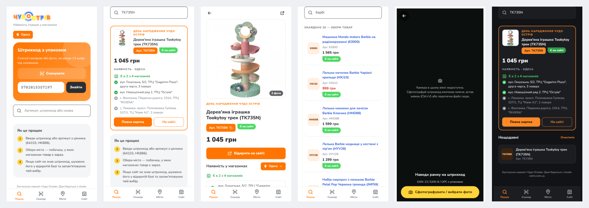
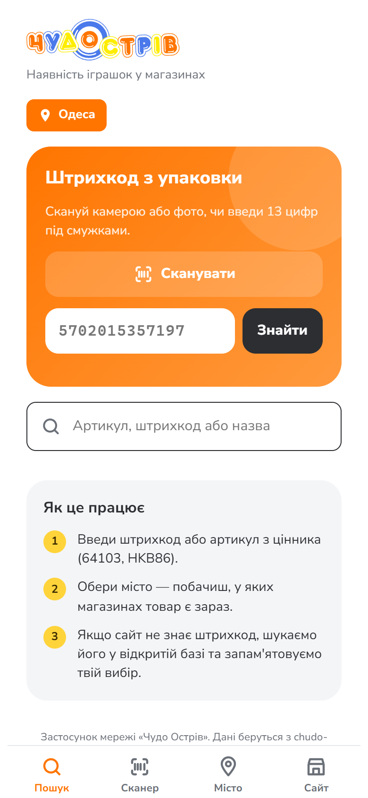
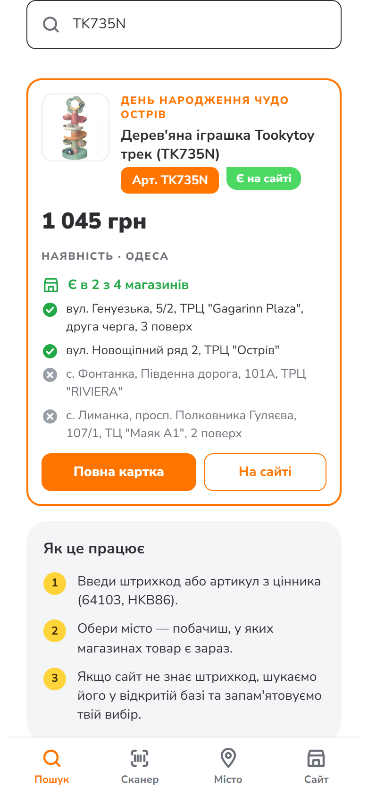
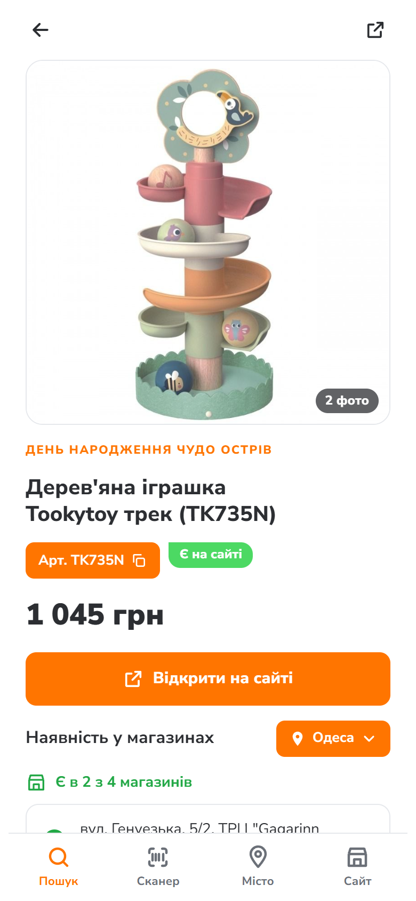
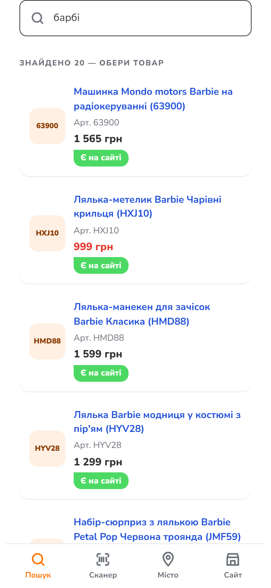
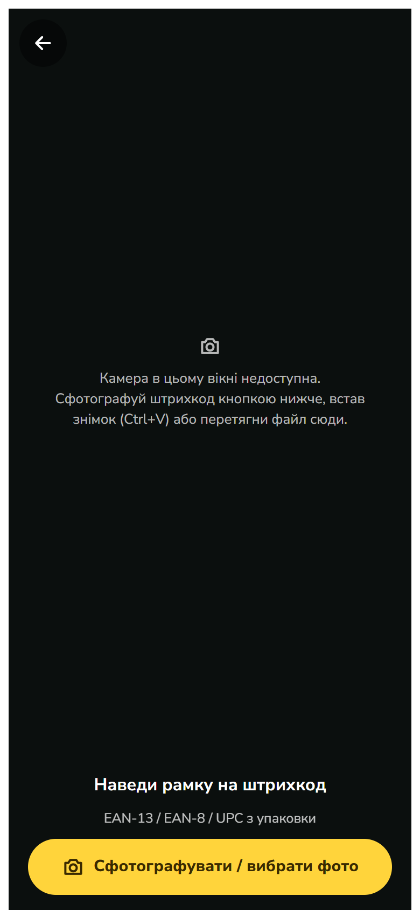
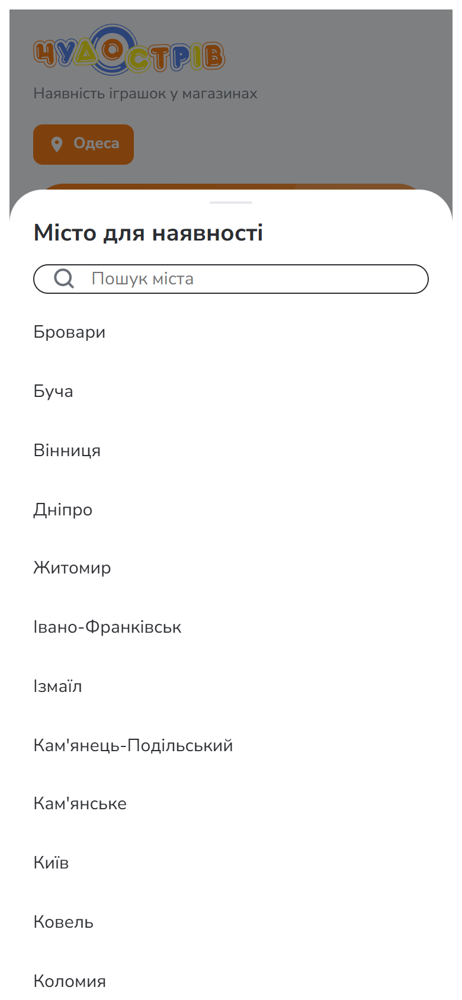
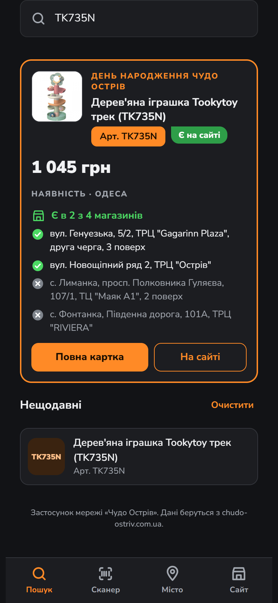
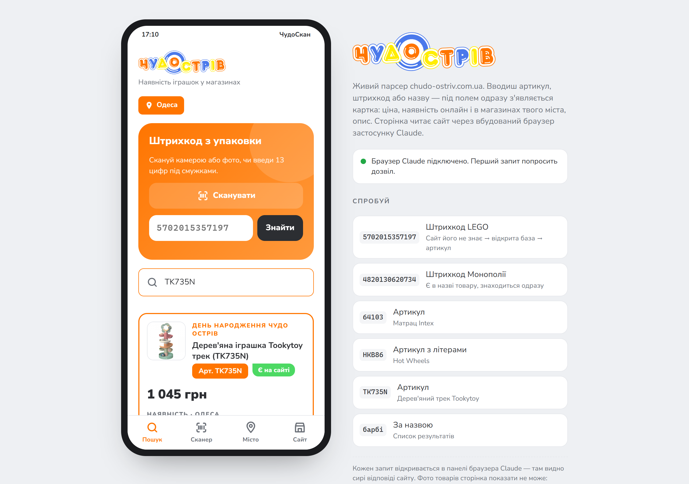

<p align="center">
  
</p>

<h3 align="center">ЧудоСкан — наличие игрушек в магазинах «Чудо Острів»</h3>

<p align="center">Штрихкод, артикул или фото упаковки → цена, наличие онлайн и в магазинах вашего города.</p>

<p align="center">
  <a href="https://github.com/Nikifor3663636/chudoskan/releases/download/v2.0/chudoskan-2.0.apk"><b>⬇ Скачать APK для Android</b></a> ·
  <a href="#скачать"><b>Все платформы</b></a> ·
  <a href="#как-устроено"><b>Как устроено</b></a>
</p>



> Приложение сети «Чудо Острів». Данные — с сайта [chudo-ostriv.com.ua](https://chudo-ostriv.com.ua).
> Логотип «Чудо Острів» — товарный знак сети.

## Что умеет

| | |
|---|---|
| 📷 **Сканер штрихкодов** | EAN-13 / EAN-8 / UPC с упаковки: камера в приложении, фото или вставка из буфера в веб-версии. |
| 🔎 **Поиск по артикулу и названию** | `TK735N`, `10698`, `барбі` — карточка появляется прямо под полем, пока вводите. |
| 🏬 **Наличие в магазинах** | 29 городов, по каждому магазину «Є / Немає» и сводка «Є в 2 з 4». |
| 🧩 **Штрихкод, которого нет на сайте** | Ищем в открытой базе UPCitemdb, достаём артикул, приложение запоминает выбор. |
| 🤖 **Фото товару** (Android) | ChatGPT определяет бренд и артикул по упаковке, если штрихкода нет. |
| 🛍 **Карточка товара** | Фото, цена, скидка, описание, кнопка «Відкрити на сайті». |
| 🌙 **Светлая и тёмная тема** | Следует настройке телефона. |

## Скриншоты

| Главный экран | Карточка при вводе | Полная карточка | Поиск по названию |
|:-:|:-:|:-:|:-:|
|  |  |  |  |

| Сканер | Выбор города | Тёмная тема |
|:-:|:-:|:-:|
|  |  |  |

Веб-версия на компьютере:



<sub>Скриншоты сняты с веб-версии на настоящих данных сайта 09.11.2026: артикул TK735N, поиск «барбі», город Одеса.</sub>

## Скачать

| Платформа | Статус | Ссылка |
|---|---|---|
| **Android** (APK) | ✅ версия 2.0 | [chudoskan-2.0.apk](https://github.com/Nikifor3663636/chudoskan/releases/download/v2.0/chudoskan-2.0.apk) · [релиз v2.0](https://github.com/Nikifor3663636/chudoskan/releases/tag/v2.0) |
| **Android** (Google Play) | не опубликовано | `GOOGLE_PLAY_URL` |
| **iOS** (App Store / TestFlight) | в планах | `APP_STORE_URL` |

### Установка на Android

1. Откройте ссылку на APK на телефоне и скачайте файл.
2. Разрешите установку из этого источника (Android спросит сам).
3. Нажмите «Установить». Нужен Android 8.0 или новее.

Если стоит версия 1.0, собранная на том же компьютере, 2.0 встанет поверх и сохранит ключ OpenAI.
Если Android пишет «приложение не установлено» — удалите старую версию и поставьте заново.

### Веб-версия


## Как устроено

```
              ┌──────────── Rust-ядро (core/) ────────────┐
 штрихкод ──▶ │ классификация · GraphQL-запросы · парсинг │ ──▶ карточка
 артикул      │ наличия · UPCitemdb → артикул · фото → AI │
              └───────▲───────────────────────▲───────────┘
                      │ UniFFI (Kotlin)        │ UniFFI (Swift) — iOS, в планах
              Android: Compose, CameraX,       iOS: SwiftUI, AVFoundation /
              ML Kit, OkHttp                   VisionKit
```

- **Данные:** GraphQL сайта (`/graphql`), наличие — `/ua/multiwarehouse/shops/index/?id=…&region=…`.
- **Rust-ядро** не ходит в сеть: только строит запросы и разбирает ответы. 26 тестов, в том числе на реальных ответах сайта.
- **Android:** Kotlin + Jetpack Compose, пакет `com.chudoostriv.app`, ставится поверх версии 1.0.
- **iOS (план):** то же Rust-ядро через UniFFI-привязки для Swift, интерфейс на SwiftUI, сканер на VisionKit.

Подробности сборки — в [README.md](README.md).
