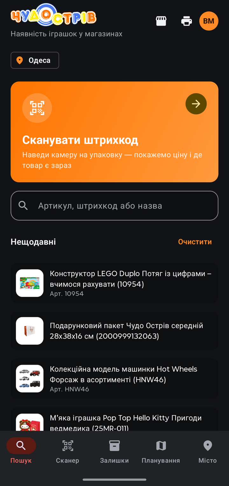
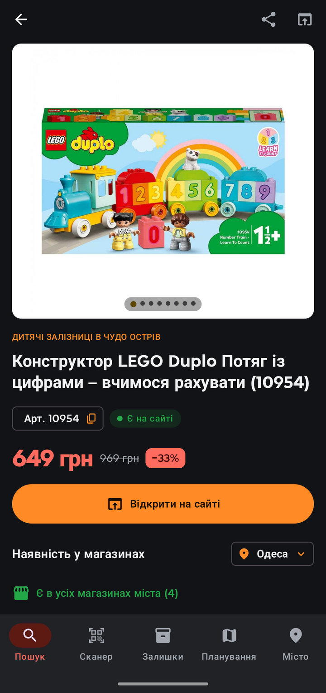
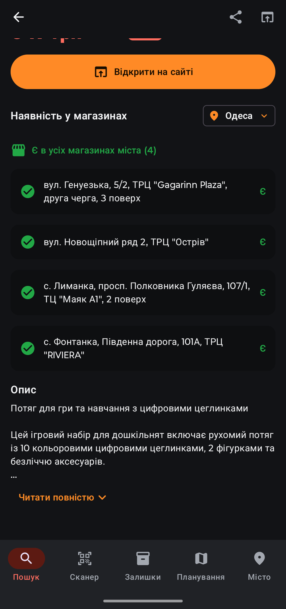
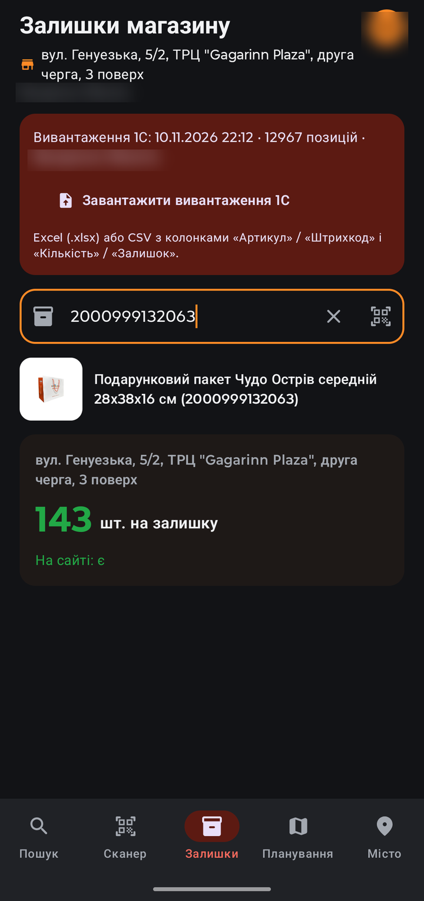
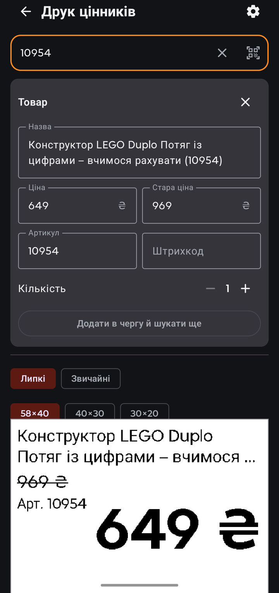
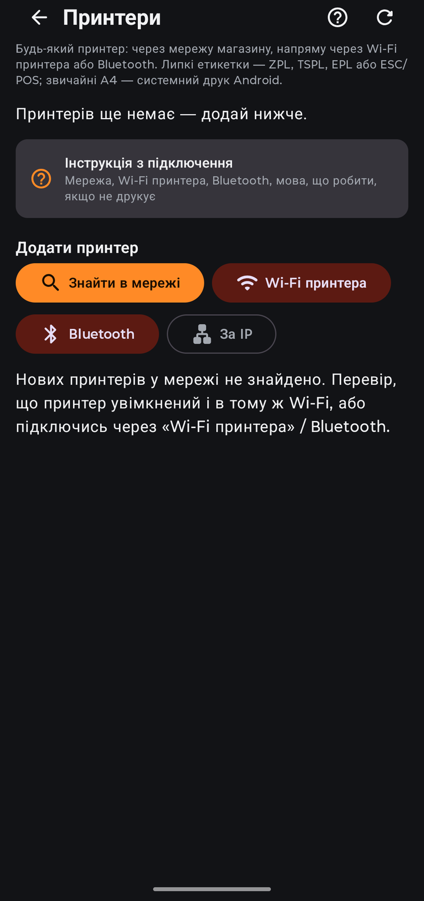
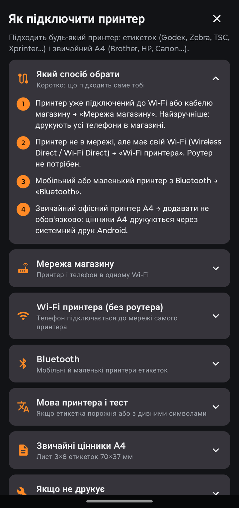
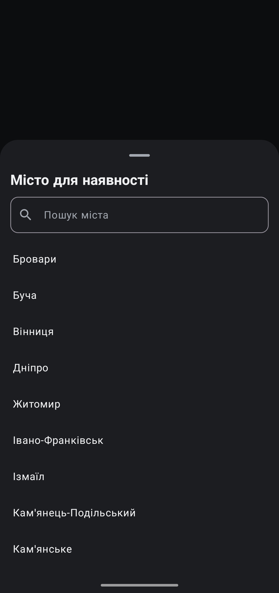
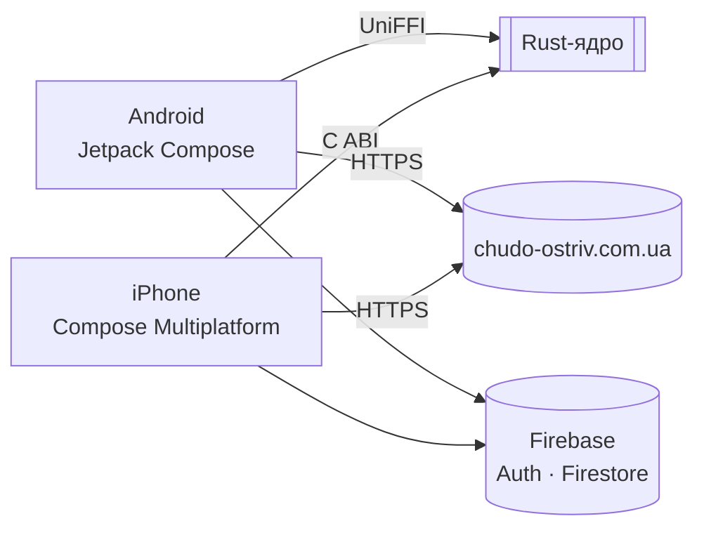

<p align="center">
  
</p>

<h1 align="center">ЧудоСкан</h1>

<p align="center">
  <b>Наличие игрушек в кармане.</b> Штрихкод, артикул или название — и за секунду видно цену,
  наличие в магазинах города и остаток в своём магазине.
</p>

<p align="center">
  <a href="https://github.com/Nikifor3663636/chudoskan/actions/workflows/android.yml"></a>
  <a href="https://github.com/Nikifor3663636/chudoskan/actions/workflows/ios.yml"></a>
  <a href="https://github.com/Nikifor3663636/chudoskan/releases/latest"></a>
  
  
</p>

<p align="center">
  <a href="https://nikifor3663636.github.io/chudoskan/"><b>Установить</b></a> ·
  <a href="#возможности"><b>Возможности</b></a> ·
  <a href="ARCHITECTURE.md"><b>Архитектура</b></a> ·
  <a href="#сборка"><b>Сборка</b></a>
</p>

<p align="center">
  <a href="docs/media/chudoskan-promo.mp4">
    
  </a>
  <br>
  <sub>Презентация за 30 секунд · <a href="docs/media/chudoskan-promo.mp4">видео в HD (MP4)</a></sub>
</p>

---

## Зачем

Покупатель спрашивает «а такой есть?» — ответ нужен за секунды. Раньше продавец искал товар на
сайте вручную, звонил в другие магазины и листал таблицы 1С. ЧудоСкан собирает всё на одном экране.

## Возможности

| | |
|---|---|
| 📷 **Сканер** | EAN-13, EAN-8, UPC-A с упаковки; код принимается после двух одинаковых кадров |
| 🔎 **Поиск** | Артикул, штрихкод или название; точное совпадение артикула подсвечивается |
| 🏬 **Наличие** | По каждому магазину выбранного города, 29 городов |
| 🧩 **Неизвестный штрихкод** | Поиск в открытой базе UPCitemdb → артикул → товар; связка запоминается |
| 📦 **Остатки** | Количество штук в своём магазине из выгрузки 1С (Excel или CSV) |
| 🏷 **Ценники** | Липкие этикетки 58×40, 40×30, 30×20 и лист A4 на 24 ценника; EAN-13 на ценнике |
| 🖨 **Принтеры** | Сеть магазина, Wi-Fi принтера, Bluetooth; ZPL, TSPL, EPL, ESC/POS |
| 🔐 **Доступ** | Вход по телефону и паролю; новый сотрудник видит данные после подтверждения администратором |
| 🌙 **Тема** | Светлая и тёмная, следует настройке телефона |

## Скриншоты

| Главный экран | Карточка товара | Наличие в магазинах | Остатки |
|:-:|:-:|:-:|:-:|
|  |  |  |  |

| Печать ценников | Принтеры | Инструкция | Выбор города |
|:-:|:-:|:-:|:-:|
|  |  |  |  |

## Установка


Откройте **[nikifor3663636.github.io/chudoskan](https://nikifor3663636.github.io/chudoskan/)** на
телефоне или наведите камеру на QR-код — страница сама покажет нужную кнопку.

- **Android 8.0+** — APK из [последнего релиза](https://github.com/Nikifor3663636/chudoskan/releases/latest).
  Разрешите установку из браузера; новая версия ставится поверх старой.
- **iPhone (iOS 15+)** — через TestFlight; ссылка появится на странице установки.

После установки: регистрация (имя, телефон, пароль, свой магазин) → администратор подтверждает
заявку → вход по номеру телефона и паролю.

## Как устроено



- **Rust-ядро** (`core/`) — запросы к сайту, разбор ответов, штрихкоды. Без сети и файлов, поэтому
  полностью покрыто тестами, в том числе на реальных ответах сайта.
- **Android** (`app/`) — Kotlin, Jetpack Compose, CameraX + ML Kit, OkHttp, Firebase.
- **iPhone** (`shared/` + `iosApp/`) — Kotlin Multiplatform и Compose Multiplatform, SwiftUI-оболочка.
- **Данные** — открытый GraphQL сайта и эндпоинт наличия; остатки и сотрудники — Firestore с
  правилами доступа по магазину.

Подробно, с диаграммами и принятыми решениями — **[ARCHITECTURE.md](ARCHITECTURE.md)**.

## Сборка

<details>
<summary><b>Android (Windows, macOS, Linux)</b></summary>

Нужно: JDK 21, Android SDK + NDK, Rust.

```bash
rustup target add aarch64-linux-android armv7-linux-androideabi x86_64-linux-android
cargo install cargo-ndk
./gradlew :app:assembleRelease   # app/build/outputs/apk/release/
```

Gradle сам собирает ядро (`cargo ndk`) и кладёт `.so` в `app/src/main/jniLibs/`.
Если ядро не менялось — `-PskipRust=true`.

</details>

<details>
<summary><b>iOS (macOS)</b></summary>

```bash
bash scripts/build-ios-core.sh                                   # libchudo_core.a для iPhone и симулятора
./gradlew :shared:linkDebugFrameworkIosSimulatorArm64            # Kotlin-фреймворк
brew install xcodegen && (cd iosApp && xcodegen)                 # проект Xcode
open iosApp/iosApp.xcodeproj
```

В CI то же самое делает [`ios.yml`](.github/workflows/ios.yml); при наличии секретов App Store Connect
сборка уходит в TestFlight.

</details>

<details>
<summary><b>Firebase</b></summary>

1. Проект в [консоли Firebase](https://console.firebase.google.com), Android-приложение `com.chudoostriv.app`.
2. `google-services.json` → в `app/` (в git не попадает; для CI — секрет `GOOGLE_SERVICES_JSON`).
3. Authentication → **Email/Password**.
4. Firestore → правила из [`firestore.rules`](firestore.rules).

Подтвердить сотрудника: Firestore → `users/{uid}` → `approved = true`.

</details>

## Проверки

```bash
cd core && cargo fmt --check && cargo clippy --all-targets -- -D warnings && cargo test
./gradlew :app:lintDebug :app:testDebugUnitTest :shared:testDebugUnitTest
```

Те же проверки запускаются в GitHub Actions на каждый push.

## Структура

```
core/          Rust-ядро: barcode, graphql, shops, upc, guard, regions, urls, ffi_c
app/           Android: data/ · print/ · ui/{home,scan,results,product,stock,print,auth,profile}
shared/        Kotlin Multiplatform: общие модели, Firebase REST, экраны Compose для iPhone
iosApp/        SwiftUI-оболочка и project.yml для XcodeGen
docs/          страница установки, видео, скриншоты, логотип
scripts/       сборка ядра для iOS, генерация привязок UniFFI
```

## Ограничения

- Сайт отдаёт наличие «есть / нет» по магазину; количество — только из выгрузки 1С.
- UPCitemdb (бесплатный тариф) — около 100 запросов в сутки; привязанные штрихкоды лимит не тратят.
- На iPhone пока нет остатков и печати ценников.

---

<sub>Данные о товарах — с сайта [chudo-ostriv.com.ua](https://chudo-ostriv.com.ua). Логотип «Чудо Острів» — товарный знак сети.</sub>
