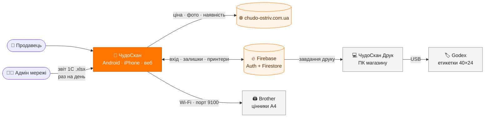
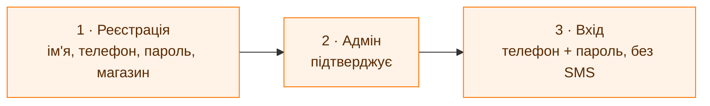
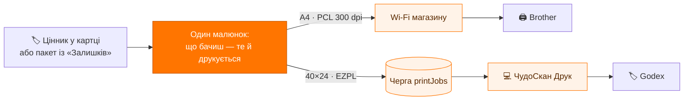
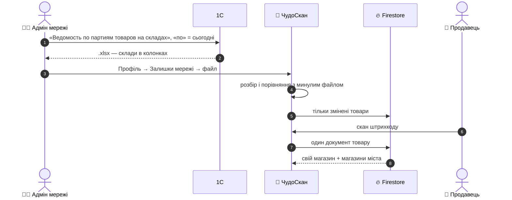
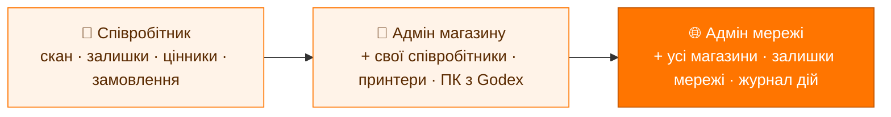
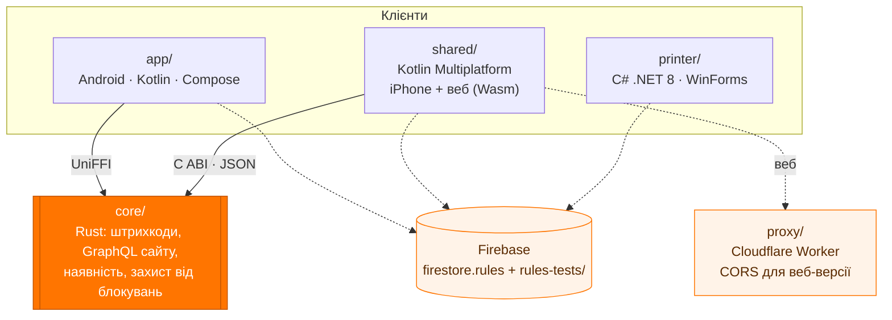

<p align="center">
  
</p>

<h1 align="center">ЧудоСкан</h1>

<p align="center">
  <b>Помічник продавця «Чудо Острів» у кишені.</b><br>
  Навів камеру на коробку — і за секунду видно ціну, скільки товару у твоєму магазині
  й у магазинах міста. Цінник — однією кнопкою.
</p>

<p align="center">
  <a href="https://github.com/Nikifor3663636/chudoskan/actions/workflows/android.yml"></a>
  <a href="https://github.com/Nikifor3663636/chudoskan/actions/workflows/printer.yml"></a>
  <a href="https://github.com/Nikifor3663636/chudoskan/actions/workflows/rules.yml"></a>
  <a href="https://github.com/Nikifor3663636/chudoskan/releases/latest"></a>
  
  
</p>

<p align="center">
  <a href="https://nikifor3663636.github.io/chudoskan/"></a>
  &nbsp;
  <a href="ARCHITECTURE.md"></a>
</p>

<p align="center">
  <a href="docs/media/chudoskan-promo.mp4">
    
  </a>
</p>

<table>
<tr>
<td width="33%" valign="top">

### 📷 Скан
Камера читає штрихкод — відкривається картка, як на сайті: фото, ціна, акція, опис.

</td>
<td width="33%" valign="top">

### 📦 Залишки
«У вашому магазині: 3 шт» і скільки в інших магазинах міста — точні числа з 1С.

</td>
<td width="33%" valign="top">

### 🏷 Цінники
Одна кнопка — цінник, як у 1С: на Brother по Wi-Fi або на Godex через ПК.

</td>
</tr>
</table>

**Зміст** · [Як це працює](#-як-це-працює) · [Встановлення](#-встановлення) · [Можливості](#-можливості) ·
[Друк](#-друк) · [Залишки мережі](#-залишки-мережі) · [Ролі](#-ролі) · [Для розробника](#-для-розробника) ·
[Безпека](#-безпека) · [Дорожня карта](#-дорожня-карта)

---

## 🧭 Як це працює



| Частина | Хто користується | Що робить |
|---|---|---|
| **📱 Застосунок** | Продавці й адміни | Скан, пошук, залишки, цінники, замовлення, адміністрування |
| **🔥 Firebase** | — (хмара) | Вхід за телефоном, ролі, залишки мережі, реєстр принтерів, черга друку |
| **💻 ЧудоСкан Друк** | Комп'ютер з Godex | Працює у фоні, бере етикетки з черги й друкує на Godex |

## 📲 Встановлення


Відкрий **[nikifor3663636.github.io/chudoskan](https://nikifor3663636.github.io/chudoskan/)** на телефоні
або наведи камеру на QR-код — сторінка сама покаже потрібну кнопку.

| Пристрій | Як поставити |
|---|---|
| 🤖 **Android 8.0+** | APK з [останнього релізу](https://github.com/Nikifor3663636/chudoskan/releases/latest); нова версія ставиться поверх старої |
| 🍏 **iPhone** | [Відкрити в Safari](https://nikifor3663636.github.io/chudoskan/app/) → «Поділитися» → «На екран „Додому“» |
| 💻 **ПК з Godex** | «ЧудоСкан Друк» — [3 кроки, без прав адміністратора](printer/README.md) |



## ✨ Можливості

| Головний екран | Картка товару | Наявність у магазинах | Залишки |
|:-:|:-:|:-:|:-:|
|  |  |  |  |

- **Пошук** — за штрихкодом, артикулом, кодом 1С (`BOC022446`) або назвою.
- **Картка товару** — як на сайті: фото, ціна, стара ціна, опис; кнопка **«Цінник»**.
- **Залишки** — свій магазин і магазини міста з кількостями з 1С; дату оновлення видно завжди.
- **Пакет цінників** — вибрати товари або взяти змінені з минулого завантаження → один документ.
- **Замовлення** — самовивіз: «Нові → Збираю → Готові», збирання сканером.
- **Нижня панель** — `Пошук · Замовлення · 📷 · Залишки · Профіль`.

## 🖨 Друк



| Шаблон | Принтер | На аркуш |
|---|---|---|
| Етикетка 40×24 | Godex | рулон |
| Цінник 68×38 | Brother | 20 альбомно · 21 книжно |
| Крупногабарит 140×100 | Brother | 4 альбомно |
| Крупногабарит 148×105 | Brother | 2 книжно |

- Штрихкод, код і артикул — **з 1С**, назва й ціна — **з сайту**. Немає ціни на сайті — цінник не друкується.
- Обраний принтер не відповідає (USB вийняли, ПК вимкнено) — застосунок **питає**, а не друкує мовчки на іншому.
- Телефон сам знаходить принтери в мережі магазину; «Принтери» бачать лише адміни.

## 📦 Залишки мережі

Адмін мережі раз на день завантажує один звіт 1С — і в усіх 46 магазинах видно точні залишки.



<details>
<summary><b>Налаштування звіту в 1С</b> (один раз, далі — «Восстановить значения»)</summary>

| Налаштування | Значення |
|---|---|
| Группировки строк | **Номенклатура** |
| Группировки колонок | **Склад** |
| Показатели | **Штрих код**, **Конечный остаток → Количество** |
| Дополнительные поля | **Код**, **Артикул** |
| Отбор | склади мережі, без «&lt;Пустое значение&gt;» |
| Период «по» | **сьогодні** |
| Збереження | **Файл → Сохранить как → .xlsx** |

</details>

Покрокова інструкція, щоденний порядок і автоматичне збереження: [docs/zvit-1c.md](docs/zvit-1c.md).

Захист від помилок: магазин без жодного товару у файлі **не обнуляється**; товарів менше половини від
минулого разу — застосунок **перепитає**; новий склад — питання **«Який це магазин?»** з підказкою.

## 👥 Ролі



| Роль | Як призначити |
|---|---|
| Співробітник | Реєструється сам, підтверджує адмін магазину або мережі |
| Адмін магазину (`admin`) | Адмін мережі в застосунку |
| Адмін мережі (`superAdmin`) · адмін залишків (`stockAdmin`) | Лише в консолі Firebase |

## 🛠 Для розробника



| Папка | Що всередині |
|---|---|
| [`core/`](core) | 🦀 Rust-ядро без мережі: запити й розбір відповідей сайту, EAN/UPC, міста |
| [`app/`](app) | 🤖 Android: `data/` · `print/` · `ui/{home,scan,results,product,stock,orders,admin,auth,profile}` |
| [`shared/`](shared) | 🍏🌐 Kotlin Multiplatform: екрани iPhone і веб-версія, Firebase через REST |
| [`printer/`](printer) | 💻 «ЧудоСкан Друк»: Core, тести, WinForms, установник Inno Setup |
| [`rules-tests/`](rules-tests) | 🔒 Тести `firestore.rules` на емуляторі |
| [`proxy/`](proxy) | ☁️ Посередник Cloudflare Workers (сайт мережі не віддає CORS) |
| [`docs/`](docs) | Сторінка встановлення, відео, знімки екрана |

<details>
<summary><b>🤖 Android</b></summary>

JDK 21, Android SDK + NDK, Rust, `cargo-ndk`. Шлях до проєкту — лише латиницею.

```bash
rustup target add aarch64-linux-android armv7-linux-androideabi x86_64-linux-android
cargo install cargo-ndk
./gradlew :app:lintDebug :app:testDebugUnitTest :app:assembleRelease
```

Ядро не мінялося — `-PskipRust=true`. Знімки дизайну — `./gradlew :app:recordPaparazziDebug`.
Тег `vX.Y` — CI збирає APK і публікує реліз.

</details>

<details>
<summary><b>💻 ЧудоСкан Друк</b></summary>

```bash
dotnet test printer/ChudoScan.Print.Tests
dotnet publish printer/ChudoScan.Print -c Release -r win-x64 --self-contained -p:PublishSingleFile=true
```

Тег `printer-vX.Y.Z` — установники x64 і x86 у релізі. Деталі — [printer/README.md](printer/README.md).

</details>

<details>
<summary><b>🔒 Правила Firestore</b></summary>

```bash
cd rules-tests && npm ci && npm test      # емулятор запускається сам (потрібна Java)
firebase deploy --only firestore:rules
```

</details>

<details>
<summary><b>🦀 Ядро · 🌐 веб · 🍏 iPhone</b></summary>

```bash
cd core && cargo fmt --check && cargo clippy --all-targets -- -D warnings && cargo test
./gradlew :shared:wasmJsBrowserDistribution       # веб-версія → GitHub Pages
bash scripts/build-ios-core.sh                    # ядро для iPhone
```

</details>

<details>
<summary><b>🔥 Консоль Firebase</b></summary>

1. Android-застосунок `com.chudoostriv.app`; `google-services.json` → `app/` (у git не потрапляє;
   для CI — секрет `GOOGLE_SERVICES_JSON`).
2. **Authentication → Sign-in method:** **Email/Password** (вхід за телефоном) і **Anonymous**
   (вхід «ЧудоСкан Друк»).
3. **Адмін мережі:** `users/<uid>` → `superAdmin = true`, `approved = true`. Адмін залишків — `stockAdmin = true`.

</details>

| CI | Що перевіряє |
|---|---|
| [`android.yml`](.github/workflows/android.yml) | Rust fmt · clippy · test → lint → unit-тести → APK |
| [`rules.yml`](.github/workflows/rules.yml) | Правила Firestore на емуляторі |
| [`printer.yml`](.github/workflows/printer.yml) | .NET-тести → установники x64/x86 → перевірка на приватні ключі |
| [`ios.yml`](.github/workflows/ios.yml) · [`pages.yml`](.github/workflows/pages.yml) | Збірка iPhone · публікація веб-версії |

Як усе влаштовано всередині — **[ARCHITECTURE.md](ARCHITECTURE.md)**.

## 🔒 Безпека

- Доступ вирішує **сервер**: [`firestore.rules`](firestore.rules) — ролі, свій магазин, поля за білим списком;
  кожне правило перевірене [тестами на емуляторі](rules-tests/rules.test.js).
- ПК з Godex входить **анонімно** й отримує права лише свого магазину після підключення кодом;
  «Відключити» одразу закриває доступ.
- Жодних ключів сервісних акаунтів, паролів і токенів у репозиторії, програмах і журналах.
- Дії адмінів пишуться в журнал `adminLog`.
- Знайшли вразливість? Повідомте приватно — **[SECURITY.md](SECURITY.md)**.

## 🗺 Дорожня карта

- [x] Скан, ціна й наявність із сайту
- [x] Залишки всієї мережі з 1С, «У магазинах міста»
- [x] Цінники з даними 1С, A4 книжно й альбомно, пакетний друк
- [x] Godex через «ЧудоСкан Друк» без ключів і без прав адміністратора
- [x] Ролі й «Адміністрування мережі»
- [ ] Залишки без інтернету: локальна база на телефоні
- [ ] Замовлення з сайту замість демо-даних, сповіщення
- [ ] iPhone-застосунок у TestFlight

---

<p align="center">
  <sub>Дані про товари — з сайту <a href="https://chudo-ostriv.com.ua">chudo-ostriv.com.ua</a>. «Чудо Острів» — товарний знак мережі.</sub>
</p>
