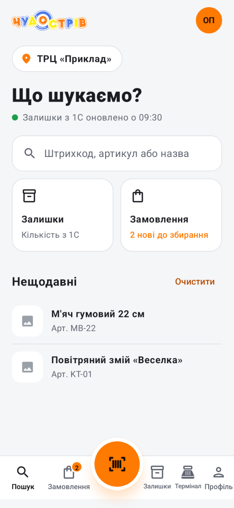
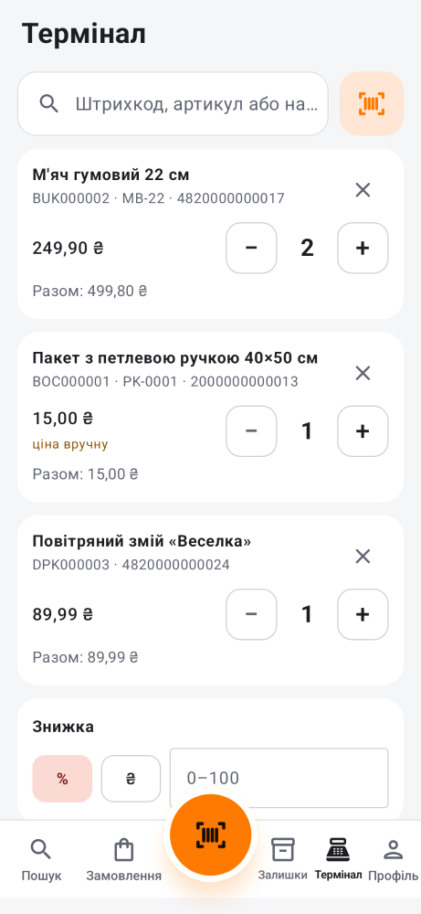
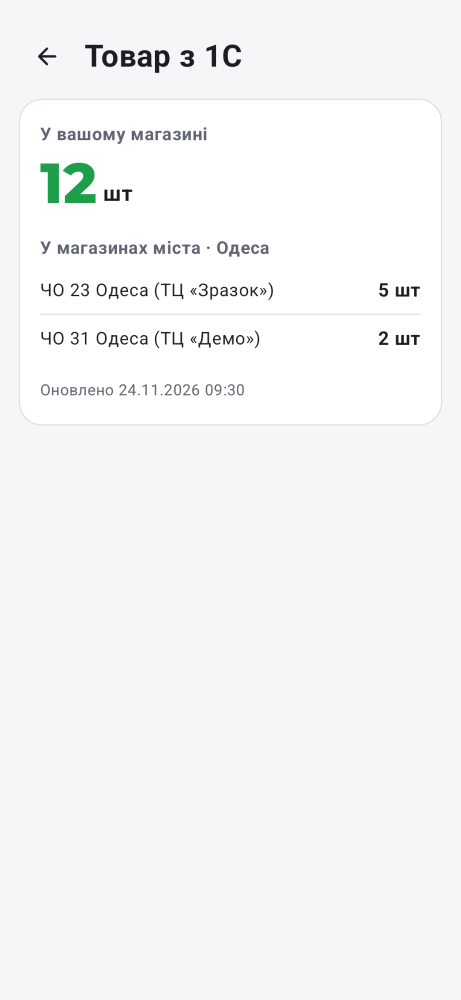
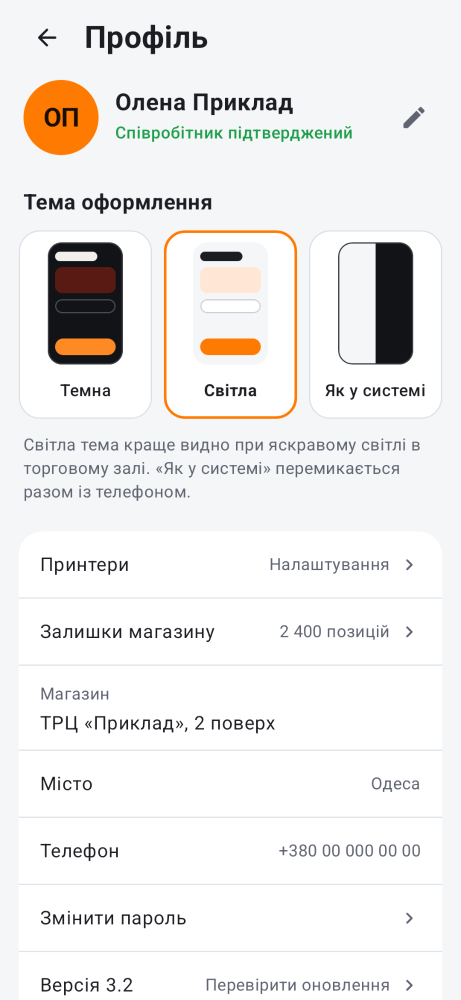
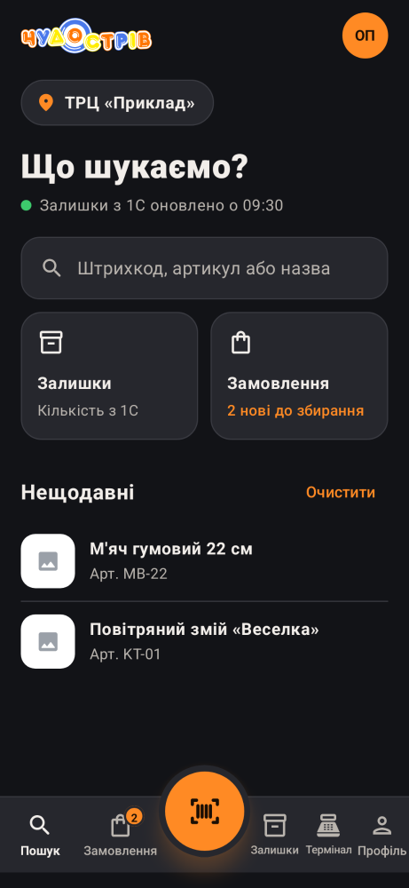
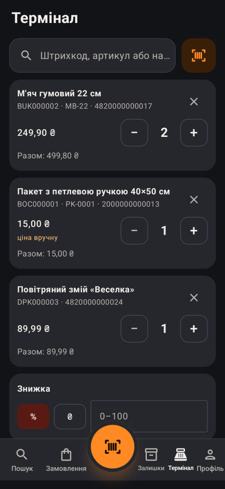
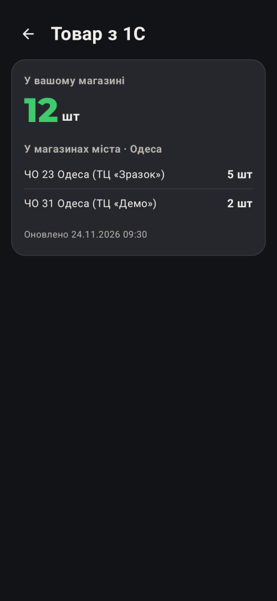
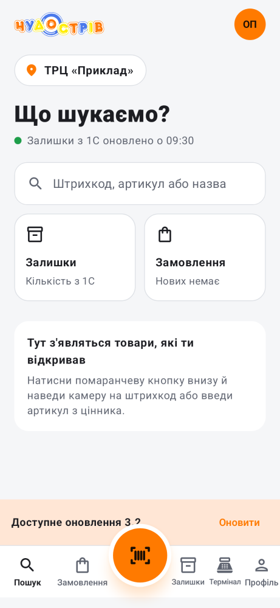
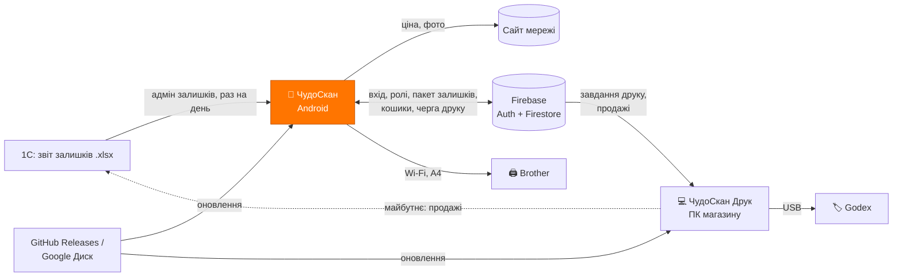

<p align="center">
  
</p>

<h1 align="center">ЧудоСкан</h1>

<p align="center"><b>Внутрішній застосунок співробітників «Чудо Острів»: скан — і одразу ціна, залишки всієї мережі з 1С, цінник і кошик для покупця.</b></p>

<p align="center">
  <a href="https://github.com/Nikifor3663636/chudoskan/actions/workflows/android.yml"></a>
  <a href="https://github.com/Nikifor3663636/chudoskan/actions/workflows/rules.yml"></a>
  <a href="https://github.com/Nikifor3663636/chudoskan/actions/workflows/printer.yml"></a>
  <a href="https://github.com/Nikifor3663636/chudoskan/releases/latest"></a>
</p>

| Головна | Термінал | Товар з 1С | Профіль |
|:-:|:-:|:-:|:-:|
|  |  |  |  |
|  |  |  |  |

<sub>Знімки — з тестів `DocsSnapshots` (Paparazzi), дані вигадані.</sub>

## Що вміє

**Консультант** (будь-який підтверджений співробітник)
- **Пошук** за штрихкодом, артикулом, кодом 1С (`BOC000001`) або назвою. Штрихкод шукається одночасно на сайті й у залишках 1С; є в 1С, немає на сайті — картка **«Товар з 1С»**.
- **Залишки**: «У вашому магазині: N шт» і магазини міста; підпис «Залишки на ДД.ММ, ГГ:ХХ». Повторний скан — без звернень до бази.
- **Цінники** однією кнопкою: Brother по Wi-Fi (A4) або Godex через ПК магазину; пакет цінників для змінених товарів.
- **Термінал**: кошик, ціна вручну для товарів без ціни на сайті, знижка, готівка й решта, «Передати на касу» з QR і кодом. Оплата карткою — після підключення банку ([docs/oplata.md](docs/oplata.md)).
- **Замовлення** на самовивіз: «Нові → Збираю → Готові».
- **Автооновлення**: банер «Доступне оновлення», «Профіль → Версія · Перевірити оновлення».

**Адмін магазину** (`admin`) — плюс підтвердження співробітників свого магазину, принтери, підключення ПК з Godex.

**Адмін залишків** (`stockAdmin`) — завантаження звіту 1С на всю мережу ([docs/zvit-1c.md](docs/zvit-1c.md)), прив'язка складів до магазинів, «Видалити старі залишки (stock/…)».

**Адмін мережі** (`superAdmin`) — усе вище для всіх магазинів, «Працювати як у магазині ЧО NN», журнал дій, **«Опублікувати оновлення»**, увімкнення оплати карткою в магазині.

`superAdmin` і `stockAdmin` ставляться лише в консолі Firebase.

## Як встановити

| Пристрій | Як |
|---|---|
| **Android 8.0+** | APK за посиланням адміна (Google Диск) або з [останнього релізу](https://github.com/Nikifor3663636/chudoskan/releases/latest). Далі оновлюється сам ([docs/onovlennia.md](docs/onovlennia.md)) |
| **ПК магазину з Godex** | «ЧудоСкан Друк» — інсталятор з релізу `printer-vX.Y.Z`, без прав адміністратора ([printer/README.md](printer/README.md)); оновлюється сам |

Сторінка встановлення з QR-кодом: [nikifor3663636.github.io/chudoskan](https://nikifor3663636.github.io/chudoskan/).

Перший вхід: реєстрація (ім'я, телефон, пароль, магазин) → адмін підтверджує → вхід телефоном і паролем.

## Як це працює



- **Залишки мережі** — один пакет на все (`stockPacks`, 2–4 документи): телефон качає його раз на версію й шукає локально.
- **Правила Firestore** вирішують доступ: свій магазин, ролі, поля за білим списком; кожне правило покрите тестами.
- **Ключі** сервісних акаунтів, банку й ПРРО ніколи не потрапляють у застосунок чи репозиторій.

Докладно — [docs/ARCHITECTURE.md](docs/ARCHITECTURE.md).

## Структура репозиторію

| Папка | Що |
|---|---|
| [`app/`](app) | Android (Kotlin, Compose): `data/` залишки й пошук, `terminal/`, `payment/`, `update/`, `print/`, `ui/` |
| [`core/`](core) | Rust-ядро (UniFFI): штрихкоди, запити й розбір відповідей сайту |
| [`shared/`](shared) | Kotlin Multiplatform: iPhone і веб-версія |
| [`printer/`](printer) | «ЧудоСкан Друк» (C#, .NET 8): Core, тести, WinForms, інсталятор |
| [`firestore.rules`](firestore.rules), [`rules-tests/`](rules-tests) | Правила доступу й тести на емуляторі |
| [`docs/`](docs) | Документація, знімки, сторінка встановлення |
| [`proxy/`](proxy) | Cloudflare Worker для веб-версії |
| [`.github/`](.github) | CI, шаблони issue і PR |

## Розробка

Потрібні JDK 21, Android SDK + NDK, Rust і `cargo-ndk`, Node.js 20+ (тести правил), .NET 8 SDK (програма для ПК).
**Шлях до проєкту — лише латиницею** (Android Gradle Plugin не збирає з кирилицею в шляху).

```bash
# Android: lint, тести (debug і release), APK
./gradlew :app:lintDebug :app:testDebugUnitTest :app:testReleaseUnitTest :app:assembleDebug
./gradlew ... -PskipRust=true                 # ядро не змінювалося
./gradlew :app:recordPaparazziDebug           # знімки екранів (app/src/test/snapshots)

# Правила Firestore — емулятор запускається сам (потрібна Java)
cd rules-tests && npm ci && npm test
firebase deploy --only firestore:rules

# Rust-ядро
cd core && cargo fmt --check && cargo clippy --all-targets -- -D warnings && cargo test

# ЧудоСкан Друк
dotnet test printer/ChudoScan.Print.Tests
```

**Емулятор Android**: debug-збірка має фейковий провайдер оплати — у Firestore `shops/{shopId}.payment = {provider: "fake"}`.
Без `google-services.json` застосунок збирається, але вхід вимкнено.

**Випуск**: тег `vX.Y` → CI збирає APK з release-ключем і публікує `ChudoSkan.apk` + `version.json`; `printer-vX.Y.Z` → інсталятори ПК.
Як випустити й зробити оновлення обов'язковим — [docs/onovlennia.md](docs/onovlennia.md), правила внеску — [CONTRIBUTING.md](CONTRIBUTING.md), історія — [CHANGELOG.md](CHANGELOG.md).

## Документація

| Документ | Для кого |
|---|---|
| [Посібник консультанта](docs/posibnyk-konsultanta.md) | скан → товар → залишки → цінник → термінал |
| [Посібник адміна](docs/posibnyk-admina.md) | 1С, магазини, принтери, співробітники, оновлення |
| [Звіт 1С](docs/zvit-1c.md) | налаштування звіту залишків |
| [Обмін продажами з 1С](docs/obmin-prodazhiv-1c.md) · [схема](docs/sale.schema.json) | програміст 1С |
| [Оплата карткою](docs/oplata.md) | підключення банку й ПРРО |
| [Оновлення](docs/onovlennia.md) | випуск версій, Google Диск, обов'язкові оновлення |
| [Архітектура](docs/ARCHITECTURE.md) | розробники |
| [Безпека](SECURITY.md) | як повідомити про вразливість |

<p align="center"><sub>Дані про товари — з сайту мережі. «Чудо Острів» — товарний знак мережі.</sub></p>
