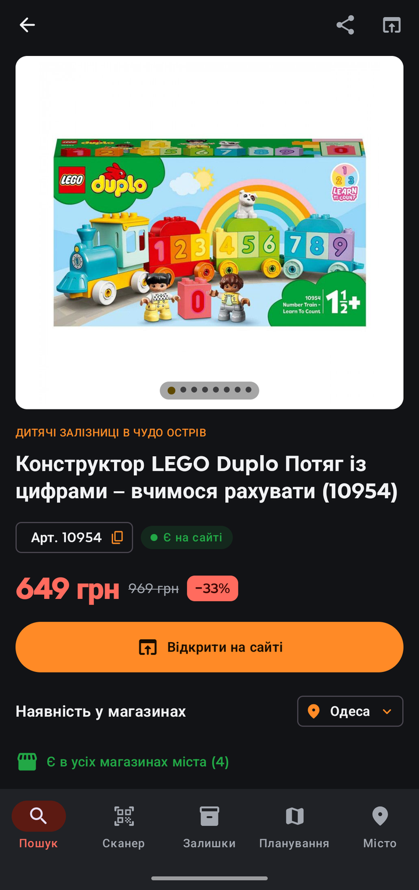

<p align="center">
  
</p>

<h1 align="center">ЧудоСкан</h1>

<p align="center">
  <b>Помічник продавця «Чудо Острів» у кишені.</b><br>
  Навів камеру на коробку — і за секунду видно ціну, скільки товару у твоєму магазині
  й у магазинах міста, а цінник друкується однією кнопкою.
</p>

<p align="center">
  <a href="https://github.com/Nikifor3663636/chudoskan/actions/workflows/android.yml"></a>
  <a href="https://github.com/Nikifor3663636/chudoskan/actions/workflows/printer.yml"></a>
  <a href="https://github.com/Nikifor3663636/chudoskan/actions/workflows/rules.yml"></a>
  <a href="https://github.com/Nikifor3663636/chudoskan/releases/latest"></a>
  
</p>

<p align="center">
  <a href="https://nikifor3663636.github.io/chudoskan/"></a>
  &nbsp;
  <a href="ARCHITECTURE.md"></a>
</p>

<p align="center">
  <a href="docs/media/chudoskan-promo.mp4">
    
  </a>
</p>

---

**Зміст:** [Для продавця](#для-продавця) · [Встановлення](#встановлення) · [Можливості](#можливості) ·
[Друк](#друк) · [Залишки мережі](#залишки-мережі) · [Ролі](#ролі) ·
[Для розробника](#для-розробника) · [Консоль Firebase](#консоль-firebase) · [Безпека](#безпека) ·
[Дорожня карта](#дорожня-карта)

## Для продавця

### Встановлення


Відкрий **[nikifor3663636.github.io/chudoskan](https://nikifor3663636.github.io/chudoskan/)** на телефоні
або наведи камеру на QR-код — сторінка сама покаже потрібну кнопку.

| Пристрій | Як поставити |
|---|---|
| 🤖 **Android 8.0+** | APK з [останнього релізу](https://github.com/Nikifor3663636/chudoskan/releases/latest); нова версія ставиться поверх старої |
| 🌐 **iPhone** | [Відкрити в Safari](https://nikifor3663636.github.io/chudoskan/app/) → «Поділитися» → «На екран „Додому“» |
| 🖨 **Комп'ютер з Godex** | Програма «ЧудоСкан Друк» — [інструкція в 3 кроки](printer/README.md) |

**Перший вхід:** реєстрація (ім'я, телефон, пароль, місто й магазин) → адмін магазину підтверджує →
вхід за номером телефону й паролем, без SMS.

### Можливості

- **Скан штрихкоду** — ціна, стара ціна, фото й опис із сайту «Чудо Острів».
- **Залишки** (вкладка в нижній панелі) — «У вашому магазині: N шт» і «У магазинах міста» з кількостями
  з 1С; пошук за штрихкодом, артикулом або кодом 1С (`BOC022446`).
- **Цінник однією кнопкою** — у картці товару «Цінник»: штрихкод, код і артикул з 1С, назва й ціна з сайту.
  Без ціни на сайті цінник не друкується.
- **Пакет цінників** — на «Залишках»: вибрати товари або взяти змінені з минулого завантаження →
  один документ на кілька аркушів.
- **Замовлення** на самовивіз зі збиранням за сканером.
- **Нижня панель:** Пошук · Замовлення · сканер · Залишки · Профіль.

| Головний екран | Картка товару | Наявність у магазинах | Залишки |
|:-:|:-:|:-:|:-:|
|  |  |  |  |

### Друк

| Принтер | Як друкує | Що налаштувати |
|---|---|---|
| **Brother** (A4: цінники 68×38, крупногабарит 148×105 і 140×100) | З телефона по Wi-Fi магазину, напряму на порт 9100 | Нічого: телефон сам знаходить принтер у мережі. Адмін — у «Профіль → Принтери» |
| **Godex** (етикетки 40×24) | Через комп'ютер магазину з програмою **«ЧудоСкан Друк»** | Встановити програму й підключити її кодом — [3 кроки](printer/README.md) |

- **Книжна / Альбомна** для кожного A4-шаблону — у вікні друку; за замовчуванням альбомна
  (68×38 — 20 на аркуш, 140×100 — 4), 148×105 — книжна (2 на аркуш).
- Якщо обраний принтер недоступний (USB вийняли, ПК вимкнено), застосунок **питає**, а не друкує мовчки на іншому.
- «Принтери» бачать лише адмін магазину й адмін мережі.

### Залишки мережі

Завантажує адмін залишків (`stockAdmin`) або адмін мережі: «Профіль → Залишки мережі» → файл `.xlsx`.
Звіт 1С **«Ведомость по партиям товаров на складах»**, налаштування:

| Налаштування звіту | Значення |
|---|---|
| Группировки строк | **Номенклатура** |
| Группировки колонок | **Склад** |
| Показатели | **Штрих код**, **Конечный остаток → Количество** |
| Дополнительные поля | **Код**, **Артикул** |
| Отбор | склади мережі, без «&lt;Пустое значение&gt;» |
| Период «по» | **сьогодні** |
| Збереження | **Файл → Сохранить как → .xlsx** |

Застосунок порівнює файл із попереднім (знімок на телефоні) і пише в базу лише змінені товари.
Перше завантаження — ~24 000 записів (застосунок попередить). Магазин без жодного товару у файлі не обнуляється;
якщо товарів менше половини від попереднього файлу — попросить підтвердження. Невідомий склад — питання
«Який це магазин?».

### Ролі

| Роль | Що може | Як призначити |
|---|---|---|
| **Співробітник** | Скан, залишки свого магазину й міста, цінники, замовлення | Реєструється сам; підтверджує адмін магазину або мережі |
| **Адмін магазину** (`admin`) | + «Мій магазин» (співробітники свого магазину), «Принтери», підключення ПК з Godex | Адмін мережі в застосунку |
| **Адмін мережі** (`superAdmin`) | + «Адміністрування мережі»: усі магазини, співробітники, «Працювати як у магазині ЧО NN», залишки мережі, історія | Лише в консолі Firebase |
| **Адмін залишків** (`stockAdmin`) | «Залишки мережі» | Лише в консолі Firebase |

## Для розробника

```
core/          Rust-ядро: штрихкоди, GraphQL сайту, магазини, захист від сторінки перевірки
app/           Android: data/ · print/ · ui/{home,scan,results,product,stock,orders,print,admin,auth,profile}
shared/        Kotlin Multiplatform: веб-версія й iPhone
printer/       «ЧудоСкан Друк» (C#, .NET 8): Core, Tests, програма WinForms, установник Inno Setup
rules-tests/   тести firestore.rules на емуляторі
proxy/         посередник Cloudflare Workers для веб-версії (сайт мережі не віддає CORS)
docs/          сторінка встановлення, відео, знімки екрана
```

<details>
<summary><b>🤖 Android</b></summary>

Потрібно: JDK 21, Android SDK + NDK, Rust, `cargo-ndk`. Шлях до проєкту — лише латиницею
(Android Gradle Plugin не працює з кирилицею в шляху).

```bash
rustup target add aarch64-linux-android armv7-linux-androideabi x86_64-linux-android
cargo install cargo-ndk
./gradlew :app:lintDebug :app:testDebugUnitTest :app:assembleRelease
```

Ядро не мінялося — `-PskipRust=true`. Знімки дизайну: `./gradlew :app:recordPaparazziDebug`.
Тег `vX.Y` — CI збирає APK і публікує реліз.

</details>

<details>
<summary><b>🖨 «ЧудоСкан Друк» (Windows)</b></summary>

```bash
dotnet test printer/ChudoScan.Print.Tests
dotnet publish printer/ChudoScan.Print -c Release -r win-x64 --self-contained -p:PublishSingleFile=true
```

Web API key і projectId у `appsettings.json` підставляє CI із секрету `GOOGLE_SERVICES_JSON`.
Тег `printer-vX.Y.Z` — установники x64 і x86 у релізі. Деталі — [printer/README.md](printer/README.md).

</details>

<details>
<summary><b>🔒 Правила Firestore</b></summary>

```bash
cd rules-tests && npm ci && npm test      # емулятор Firestore запускається сам (потрібна Java)
```

</details>

<details>
<summary><b>🦀 Ядро, веб, iPhone</b></summary>

```bash
cd core && cargo fmt --check && cargo clippy --all-targets -- -D warnings && cargo test
./gradlew :shared:wasmJsBrowserDistribution       # веб-версія → GitHub Pages (pages.yml)
bash scripts/build-ios-core.sh                    # ядро для iPhone (ios.yml)
```

</details>

### Консоль Firebase

1. Проєкт у [консолі Firebase](https://console.firebase.google.com), Android-застосунок `com.chudoostriv.app`;
   `google-services.json` → в `app/` (у git не потрапляє; для CI — секрет `GOOGLE_SERVICES_JSON`).
2. **Authentication → Sign-in method:** увімкнути **Email/Password** (вхід за телефоном) і **Anonymous**
   (вхід програми «ЧудоСкан Друк» на ПК).
3. **Адмін мережі:** Firestore → `users/<uid>` → поле `superAdmin` = `true` (boolean), і `approved` = `true`.
   Адмін залишків — так само поле `stockAdmin` = `true`. З застосунку ці поля не змінює ніхто.
4. **Правила:** `firebase deploy --only firestore:rules`.

## Безпека

- Доступ до даних вирішує **сервер**: [`firestore.rules`](firestore.rules) — ролі, свій магазин, поля за білим списком;
  кожне правило перевірене тестами на емуляторі ([`rules-tests/`](rules-tests/rules.test.js)).
- Комп'ютер магазину входить **анонімно** й отримує доступ лише після підключення кодом адміном магазину;
  «Відключити» одразу закриває доступ. Жодних ключів сервісних акаунтів, паролів чи токенів у репозиторії,
  програмах і журналах; CI перевіряє установники на приватні ключі.
- Дії адмінів записуються в журнал `adminLog`.
- Знайшли вразливість? Повідомте приватно — **[SECURITY.md](SECURITY.md)**.

## Дорожня карта

- [x] Скан, ціна й наявність із сайту; залишки свого магазину
- [x] Цінники на Brother (Wi-Fi) з даними 1С, A4 книжно й альбомно, пакетний друк
- [x] Залишки всієї мережі зі звіту 1С; «У магазинах міста»
- [x] Ролі й «Адміністрування мережі»
- [x] Godex через «ЧудоСкан Друк» на ПК без ключів сервісного акаунта
- [ ] iPhone-застосунок у TestFlight
- [ ] Замовлення з сайту замість демо-даних
- [ ] Сповіщення про нові замовлення
