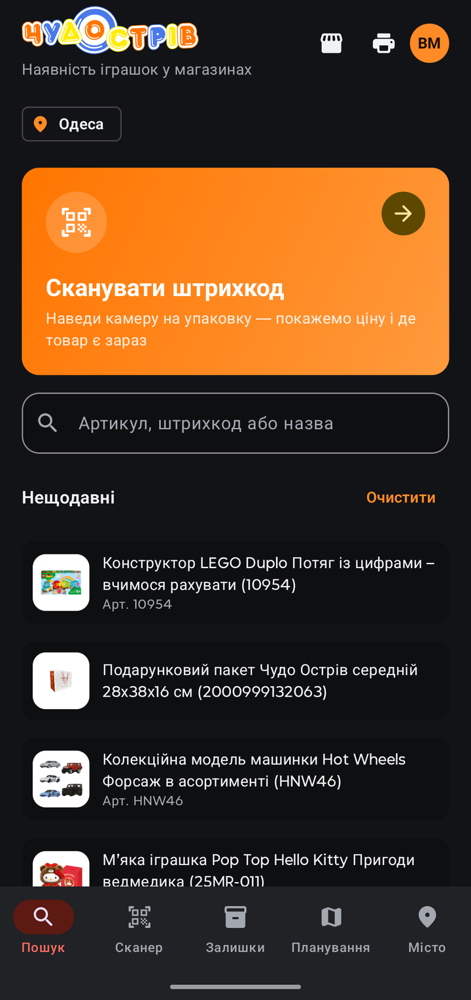
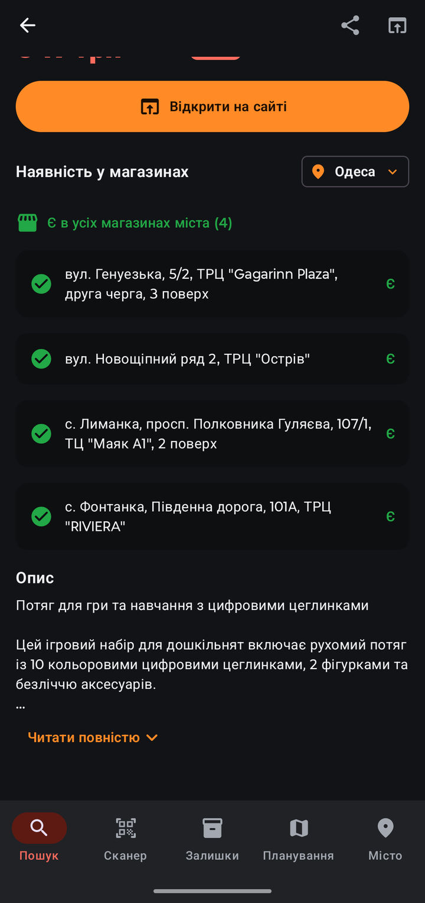
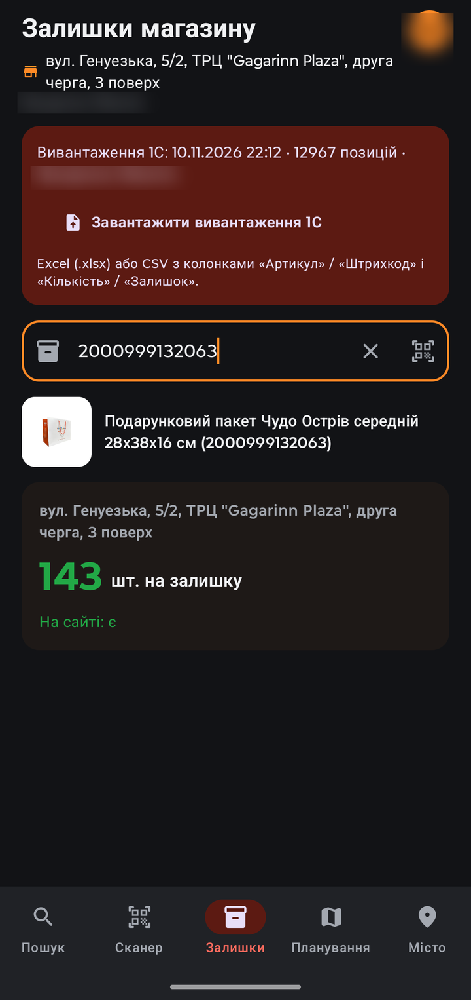
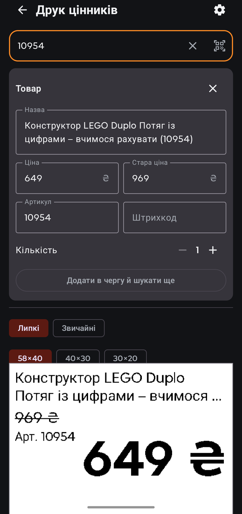
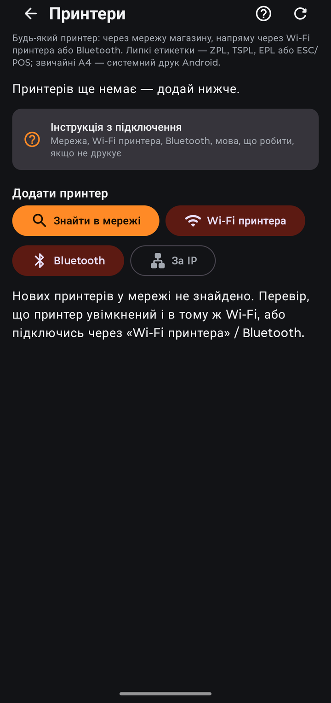
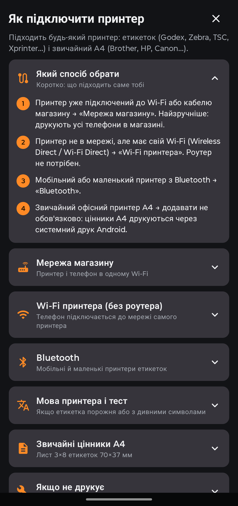
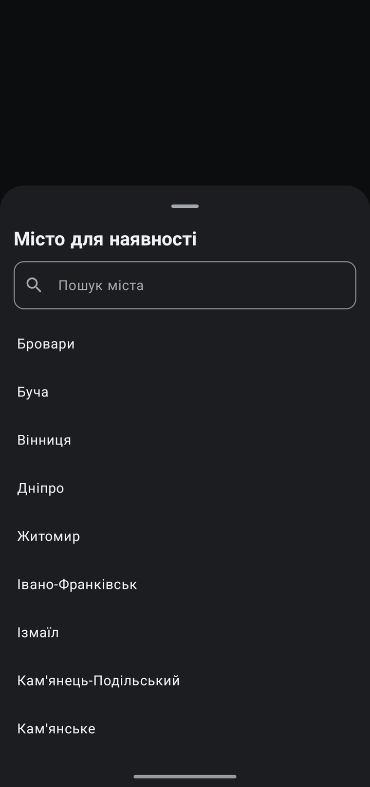
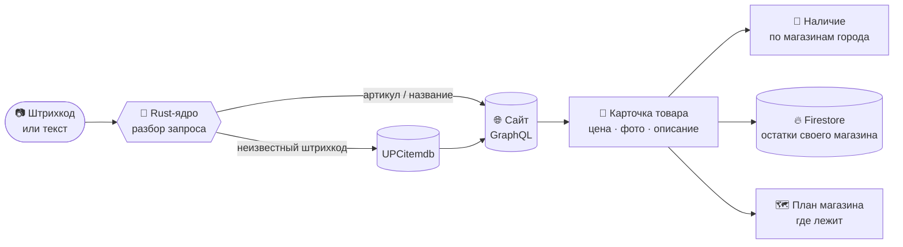

<p align="center">
  
</p>

<h1 align="center">ЧудоСкан</h1>

<p align="center">
  <b>Помощник продавца «Чудо Острів» в кармане.</b><br>
  Навёл камеру на коробку — и за секунду видно цену, в каких магазинах города есть товар,
  сколько штук у тебя на складе и на какой полке он лежит.
</p>

<p align="center">
  <a href="https://github.com/Nikifor3663636/chudoskan/actions/workflows/android.yml"></a>
  <a href="https://github.com/Nikifor3663636/chudoskan/actions/workflows/ios.yml"></a>
  <a href="https://github.com/Nikifor3663636/chudoskan/releases/latest"></a>
  
  
  <a href="SECURITY.md"></a>
</p>

<p align="center">
  <a href="https://nikifor3663636.github.io/chudoskan/"></a>
  &nbsp;
  <a href="#how"></a>
  &nbsp;
  <a href="ARCHITECTURE.md"></a>
</p>

<p align="center">
  <a href="docs/media/chudoskan-promo.mp4">
    
  </a>
  <br>
  <sub>Презентация за 30 секунд · <a href="docs/media/chudoskan-promo.mp4">видео в HD (MP4)</a></sub>
</p>

---

## 💡 Зачем

Покупатель спрашивает: *«А такой есть? А в другом магазине? А где он у вас?»*

| Раньше | С ЧудоСканом |
|---|---|
| Ищешь товар на сайте вручную | 📷 Сканируешь штрихкод — товар открыт |
| Звонишь в соседние магазины | 🏬 Наличие по всем магазинам города на одном экране |
| Листаешь выгрузку 1С | 📦 Остаток своего магазина — сразу в карточке |
| Обходишь зал в поисках полки | 🗺 Карта магазина с мигающей меткой «здесь» |
| Ценник — через компьютер с 1С | 🏷 Печать ценника с телефона, в формате 1С |

## ✨ Возможности

<table>
<tr>
<td width="50%" valign="top">

### 🛒 В торговом зале
- **📷 Сканер** — EAN-13, EAN-8, UPC-A. Код засчитывается после двух одинаковых кадров, без ложных срабатываний.
- **🔎 Поиск** — артикул, штрихкод или название; точное совпадение артикула подсвечивается.
- **🏬 Наличие** — по каждому магазину выбранного города, 29 городов.
- **🗺 Где лежит** — план магазина: ищешь бренд или сканируешь товар, карта сама приближается к нужным стеллажам.

</td>
<td width="50%" valign="top">

### 🧾 Для работы магазина
- **📦 Остатки** — количество штук из выгрузки 1С (Excel или CSV), видно только сотрудникам своего магазина.
- **🏷 Ценники как в 1С** — этикетка 40×25, ценник 68×38, крупногабарит на A4, акционные с перечёркнутой ценой.
- **🖨 Любой принтер** — сеть магазина, Wi-Fi принтера, Bluetooth; ZPL, TSPL, EPL, ESC/POS, PDF.
- **📍 Уточнения** — сотрудник ставит метку «товар здесь», её видят все коллеги.

</td>
</tr>
<tr>
<td valign="top">

### 🧩 Если штрихкода нет на сайте
Поиск в открытой базе UPCitemdb → артикул → товар. Найденная связка запоминается, второй раз — мгновенно.

</td>
<td valign="top">

### 🔐 Доступ
Вход по телефону и паролю. Новый сотрудник видит данные магазина только после подтверждения администратором.

</td>
</tr>
</table>

## 📸 Скриншоты

| Главный экран | Карточка товара | Наличие в магазинах | Остатки |
|:-:|:-:|:-:|:-:|
|  |  |  |  |

| Печать ценников | Принтеры | Инструкция | Выбор города |
|:-:|:-:|:-:|:-:|
|  |  |  |  |

## 📲 Установка


Откройте **[nikifor3663636.github.io/chudoskan](https://nikifor3663636.github.io/chudoskan/)** на телефоне
или наведите камеру на QR-код — страница сама покажет нужную кнопку.

| Платформа | Как поставить | Статус |
|---|---|---|
| 🤖 **Android 8.0+** | APK из [последнего релиза](https://github.com/Nikifor3663636/chudoskan/releases/latest), новая версия ставится поверх старой | ✅ Доступно |
| 🍏 **iPhone, iOS 15+** | Через TestFlight от Apple — ссылка появится на странице установки | 🛠 Собирается в CI, ждёт публикации в TestFlight |

**Первый вход — 3 шага:**

1. **Регистрация** — имя, телефон, пароль, свой город и магазин.
2. **Подтверждение** — администратор открывает доступ к данным магазина.
3. **Вход** — по номеру телефона и паролю, без SMS.

<a id="how"></a>

## ⚙️ Как это работает



Одна логика — две платформы:

```mermaid
flowchart LR
    A[🤖 Android<br/>Jetpack Compose] -- UniFFI --> C[[🦀 Rust-ядро]]
    I[🍏 iPhone<br/>Compose Multiplatform] -- C ABI --> C
    A & I --> L[[🗺 Общий код плана<br/>Kotlin]]
    A & I -- HTTPS --> W[(chudo-ostriv.com.ua)]
    A & I --> F[(Firebase<br/>Auth · Firestore)]
```



| Слой | Технологии |
|---|---|
| 🦀 **Ядро** `core/` | Rust: запросы к сайту, разбор ответов, штрихкоды EAN/UPC. Без сети и файлов — полностью покрыто тестами на реальных ответах сайта |
| 🤖 **Android** `app/` | Kotlin, Jetpack Compose, CameraX + ML Kit, OkHttp, DataStore, Firebase; R8 в релизе |
| 🍏 **iPhone** `shared/` + `iosApp/` | Kotlin Multiplatform, Compose Multiplatform, Ktor, AVFoundation, Firebase через REST |
| 🔥 **Данные** | GraphQL сайта, Firestore с правилами доступа по магазину |
| 🧪 **Качество** | GitHub Actions: `clippy -D warnings`, Android lint без предупреждений, unit-тесты, сборка iOS на macOS; Dependabot |

Подробно, с диаграммами и принятыми решениями — **[ARCHITECTURE.md](ARCHITECTURE.md)**.

## 🔒 Безопасность

- Доступ к данным решает **сервер**, а не приложение: [`firestore.rules`](firestore.rules) пускают только подтверждённых сотрудников своего магазина, поля документов — по белому списку.
- Ключи Firebase и Apple — только в секретах GitHub, не в репозитории.
- Данные приложения не попадают в облачные бэкапы телефона (там пароли Wi-Fi принтеров).
- Включены Dependabot, secret scanning и защита от пуша секретов.

Нашли уязвимость? Сообщите приватно — **[SECURITY.md](SECURITY.md)**.

## 🛠 Разработка

<details>
<summary><b>🤖 Сборка Android</b> (Windows, macOS, Linux)</summary>

Нужно: JDK 21, Android SDK + NDK, Rust.

```bash
rustup target add aarch64-linux-android armv7-linux-androideabi x86_64-linux-android
cargo install cargo-ndk
./gradlew :app:assembleRelease   # → app/build/outputs/apk/release/
```

Gradle сам собирает ядро (`cargo ndk`) и кладёт `.so` в `app/src/main/jniLibs/`.
Если ядро не менялось — `-PskipRust=true`.

</details>

<details>
<summary><b>🍏 Сборка iOS</b> (macOS)</summary>

```bash
bash scripts/build-ios-core.sh                          # libchudo_core.a для iPhone и симулятора
./gradlew :shared:linkDebugFrameworkIosSimulatorArm64   # Kotlin-фреймворк
brew install xcodegen && (cd iosApp && xcodegen)        # проект Xcode
open iosApp/iosApp.xcodeproj
```

В CI то же делает [`ios.yml`](.github/workflows/ios.yml). С секретами App Store Connect
(`APPLE_TEAM_ID`, `ASC_KEY_ID`, `ASC_ISSUER_ID`, `ASC_KEY_P8`) сборка сама уходит в TestFlight.

</details>

<details>
<summary><b>🔥 Firebase</b></summary>

1. Проект в [консоли Firebase](https://console.firebase.google.com), Android-приложение `com.chudoostriv.app`.
2. `google-services.json` → в `app/` (в git не попадает; для CI — секрет `GOOGLE_SERVICES_JSON`).
3. Authentication → **Email/Password** (вход по телефону работает поверх него).
4. Правила: `firebase deploy --only firestore:rules`.

Подтвердить сотрудника: Firestore → `users/{uid}` → `approved = true`.

</details>

<details>
<summary><b>🗺 Добавить план нового магазина</b></summary>

Папка `shared/src/commonMain/composeResources/files/layout/{shopId}/`:

- `map.webp` — картинка плана;
- `layout.json` — подписи брендов и стеллажи:
  `{ shopId, imageSize: [w, h], labels: [{ text, box: [x, y, w, h] }], sections: [...] }`,
  координаты — доли 0..1 от размера картинки.

Синонимы брендов («хот вілс» → Hot Wheels) — в `layout/synonyms.json`. Android и iPhone берут файлы из одной папки.

</details>

<details>
<summary><b>✅ Проверки перед коммитом</b></summary>

```bash
cd core && cargo fmt --check && cargo clippy --all-targets -- -D warnings && cargo test
./gradlew :app:lintDebug :app:testDebugUnitTest :shared:testDebugUnitTest
```

Те же проверки запускаются в GitHub Actions на каждый push и pull request.

</details>

<details>
<summary><b>📁 Структура репозитория</b></summary>

```
core/          🦀 Rust-ядро: barcode, graphql, shops, upc, guard, regions, urls, ffi_c
app/           🤖 Android: data/ · print/ · ui/{home,scan,results,product,stock,layout,print,auth,profile}
shared/        🍏 Kotlin Multiplatform: модели, Firebase REST, экраны для iPhone, план магазина
iosApp/        SwiftUI-оболочка и project.yml для XcodeGen
docs/          страница установки, видео, скриншоты, логотип
scripts/       сборка ядра для iOS, генерация привязок UniFFI
```

</details>

## 🗺 Дорожная карта

- [x] Сканер, поиск, наличие по городу
- [x] Остатки магазина из 1С
- [x] Печать ценников в форматах 1С на любой принтер
- [x] План магазина «где лежит товар» — Android и iPhone
- [ ] iPhone в TestFlight
- [ ] Остатки и ценники на iPhone
- [ ] Печать на Godex через ПК магазина (агент + очередь заданий)
- [ ] Планы остальных магазинов сети

## ⚠️ Ограничения

- Сайт отдаёт наличие «есть / нет» по магазину; количество штук — только из выгрузки 1С.
- UPCitemdb (бесплатный тариф) — около 100 запросов в сутки; уже привязанные штрихкоды лимит не тратят.
- На iPhone пока нет остатков и печати ценников; метки на плане ставятся с Android, на iPhone — видны.
- План магазина пока есть для ЧО 22 Одеса (Gagarin Plaza).

---

<p align="center">
  <sub>Данные о товарах — с сайта <a href="https://chudo-ostriv.com.ua">chudo-ostriv.com.ua</a>. Логотип «Чудо Острів» — товарный знак сети.</sub>
</p>
