# Архітектура ЧудоСкан

З чого складається ЧудоСкан, як частини пов'язані і чому вони влаштовані саме так.
Встановлення й збірка — у [README](../README.md).

**Зміст** · [1. Огляд](#1-огляд) · [2. Модулі](#2-модулі) · [3. Rust-ядро](#3-rust-ядро) ·
[4. Мости ядра](#4-мости-ядра) · [5. Android](#5-android) · [6. iPhone і веб](#6-iphone-і-веб) ·
[7. Пошук товару](#7-пошук-товару) · [8. Дані у Firestore](#8-дані-у-firestore) · [9. Вхід і ролі](#9-вхід-і-ролі) ·
[10. Залишки мережі](#10-залишки-мережі) · [10a. Термінал і оплата](#10a-термінал-і-оплата) · [10b. Оновлення](#10b-оновлення) · [11. Друк](#11-друк) · [12. ЧудоСкан Друк](#12-чудоскан-друк) ·
[13. Збірка і CI](#13-збірка-і-ci) · [14. Тести](#14-тести) · [15. Рішення](#15-рішення) · [16. Обмеження](#16-обмеження)

---

## 1. Огляд

Продавець сканує штрихкод і за секунду бачить ціну, залишок у своєму магазині й у магазинах міста,
а цінник друкується однією кнопкою.

**Три принципи:**

| | Принцип | Навіщо |
|---|---|---|
| 🦀 | **Одна логіка даних сайту** — на Rust | Однаково працює на Android, iPhone і в вебі; тести на справжніх відповідях сайту |
| 🧪 | **Ядро без вводу-виводу** | Rust не ходить у мережу: будує запити й розбирає відповіді — легко тестувати |
| 🔒 | **Права вирішує сервер** | Кожен доступ до Firestore перевіряють `firestore.rules`, покриті тестами |

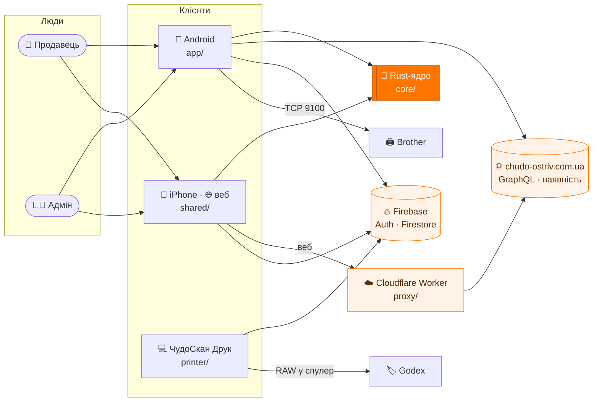

## 2. Модулі

| Модуль | Мова | Призначення |
|---|---|---|
| [`core/`](../core) | Rust | Запити до сайту й розбір відповідей, штрихкоди EAN/UPC, міста, розпізнавання блокувань |
| [`app/`](../app) | Kotlin, Jetpack Compose | Android: сканер, пошук, картка, залишки, друк, замовлення, адміністрування |
| [`shared/`](../shared) | Kotlin Multiplatform, Compose Multiplatform | Екрани iPhone і веб-версії (Wasm), Firebase через REST |
| [`iosApp/`](../iosApp) | Swift | Тонка оболонка iPhone для екранів `shared` |
| [`printer/`](../printer) | C#, .NET 8, WinForms | «ЧудоСкан Друк» — друк на Godex з ПК магазину |
| [`proxy/`](../proxy) | JavaScript | Cloudflare Worker: CORS для веб-версії (білий список шляхів) |
| [`firestore.rules`](../firestore.rules) · [`rules-tests/`](../rules-tests) | Rules, JS | Хто що бачить у базі, і тести цього на емуляторі |
| [`docs/`](../docs) | HTML | Сторінка встановлення (GitHub Pages), відео, знімки |

Залежності спрямовані лише всередину: клієнти залежать від ядра, ядро не знає про клієнтів.

## 3. Rust-ядро

| Файл | Що робить |
|---|---|
| `barcode.rs` | Тип вводу (EAN-13, EAN-8, UPC-A, артикул, текст), контрольна цифра, смуги EAN-13 для цінника |
| `graphql.rs` | Тіла запитів Magento GraphQL (через `variables`) і розбір відповідей; точний збіг артикула |
| `shops.rs` | Розбір HTML наявності по магазинах |
| `upc.rs` | Відповідь UPCitemdb → імовірні артикули з назви |
| `guard.rs` | Сторінка перевірки Cloudflare, 403/429/503 |
| `regions.rs` · `urls.rs` · `model.rs` | Міста сайту, адреси, спільні типи |
| `ffi_c.rs` | C-інтерфейс для iPhone: `chudo_call(метод, JSON)` |

Функції чисті: на вхід рядок — на вихід значення або `CoreError`. У релізі `opt-level = "z"`, LTO,
`panic = "abort"`: бібліотека для arm64 — близько 1,5 МБ.

## 4. Мости ядра

| | Android | iPhone |
|---|---|---|
| Механізм | [UniFFI](https://mozilla.github.io/uniffi-rs/) → Kotlin-обгортка | C ABI → Kotlin/Native `cinterop` |
| Бібліотека | `libchudo_core.so` (cargo-ndk, 3 ABI) | `libchudo_core.a` (статична) |
| Виклик | Типізовані функції | Одна функція `chudo_call("method", "{json}")` |

UniFFI не генерує код для Kotlin/Native, тому для iPhone — JSON-міст. Щоб моделі по обидва боки
не розійшлися, `CoreContractTest` проганяє Kotlin-моделі `shared` через справжнє ядро.

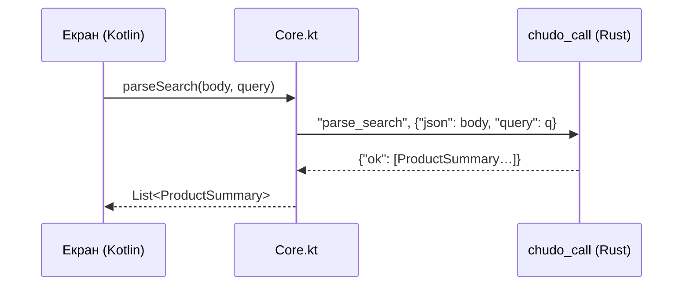

## 5. Android

Звичайні шари Compose-застосунку, без DI-фреймворку: усі залежності створює `ChudoApp`.

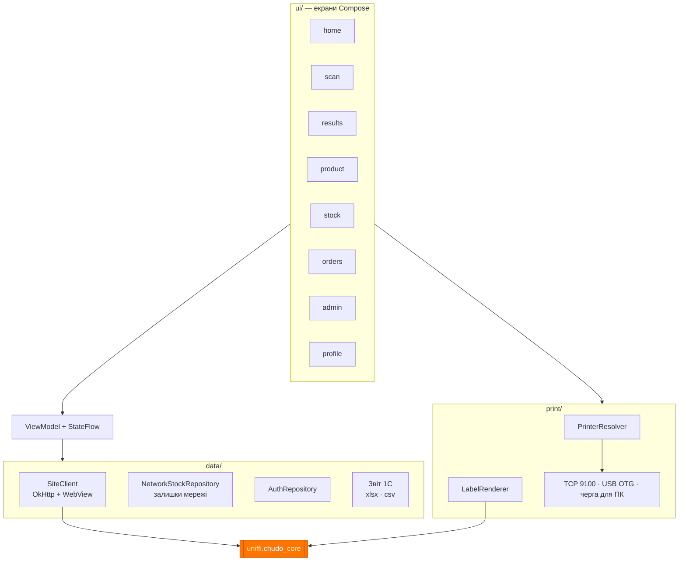

- **Камера:** CameraX + ML Kit Barcode; код приймається, якщо збігся у двох кадрах поспіль.
- **Мережа:** OkHttp; якщо Cloudflare повернув сторінку перевірки — повтор через невидимий WebView.
- **Стан:** `StateFlow` у ViewModel, у Compose — `collectAsStateWithLifecycle`.
- **Дизайн:** стиль «Mine», світла й темна тема, фірмовий помаранчевий `#FF7500`.
- **Навігація:** `Пошук · Замовлення · 📷 · Залишки · Термінал · Профіль`.

## 6. iPhone і веб

Екрани пишуться один раз на Kotlin (Compose Multiplatform) і малюються на iPhone та у браузері (Wasm).
Платформне — через `expect`/`actual`:

| `expect` | Android | iPhone | Веб |
|---|---|---|---|
| Сховище | SharedPreferences | `NSUserDefaults` | `localStorage` |
| HTTP | Ktor + OkHttp | Ktor + Darwin | Ktor + fetch через `proxy/` |
| Сканер | — | AVFoundation | фото камерою |

Firebase на iPhone і в вебі — **через REST** (Identity Toolkit, Secure Token, Firestore REST):
модуль лишається чистим Kotlin без CocoaPods. Проєкт Xcode генерує XcodeGen з `iosApp/project.yml`.

## 7. Пошук товару

Сайт не індексує штрихкоди, тому штрихкод шукається **одночасно** на сайті й у залишках 1С.
Рішення — чистий клас `LookupEngine` (сайт, 1С і відкрита база штрихкодів підставляються ззовні, у тестах — фейки).

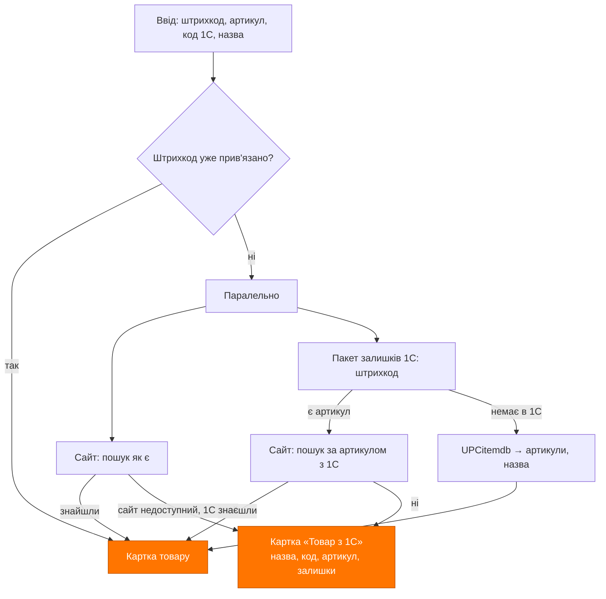

| Що | Як |
|---|---|
| Пошук, картка | `POST /graphql`, заголовок `Store: ua` |
| Артикул | поле `external_id` |
| Наявність на сайті | `GET /ua/multiwarehouse/shops/index/?id={id}&region={код}` |
| Кількість з 1С | локальний пакет залишків (без читань Firestore після завантаження) |
| Штрихкод без 1С | збережена прив'язка, далі `api.upcitemdb.com` (≈100 запитів на добу) |

## 8. Дані у Firestore

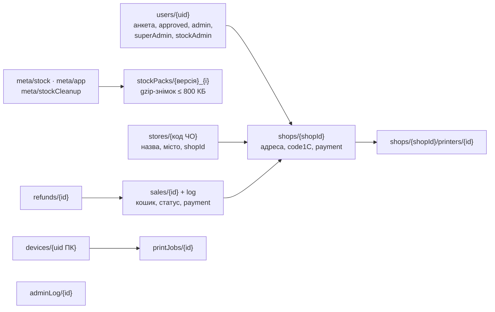

| Колекція | Хто пише | Хто читає |
|---|---|---|
| `users` | сам (анкета), адмін (права) | сам, адмін свого магазину, адмін мережі |
| `shops` · `printers` | адмін магазину / мережі, телефони (реєстр); `payment` — лише адмін мережі | співробітники магазину |
| `stockPacks` · `stores` · `meta/stock` | адмін залишків | усі підтверджені |
| `stock/{штрихкод}` | старий формат: лише читання й видалення адміном залишків | — (застосунок більше не читає) |
| `sales` · `sales/{id}/log` · `refunds` | співробітник свого магазину (статус лише вперед), ПК магазину (`fiscal`, `exported1C`, `verified`) | свій магазин, адмін мережі |
| `meta/app` | адмін мережі | усі підтверджені |
| `devicePairing` · `devices` · `agents` · `printJobs` | ПК, адмін, співробітники (завдання) | магазин, ПК-адресат |
| `adminLog` | адміни | адмін мережі |

## 9. Вхід і ролі

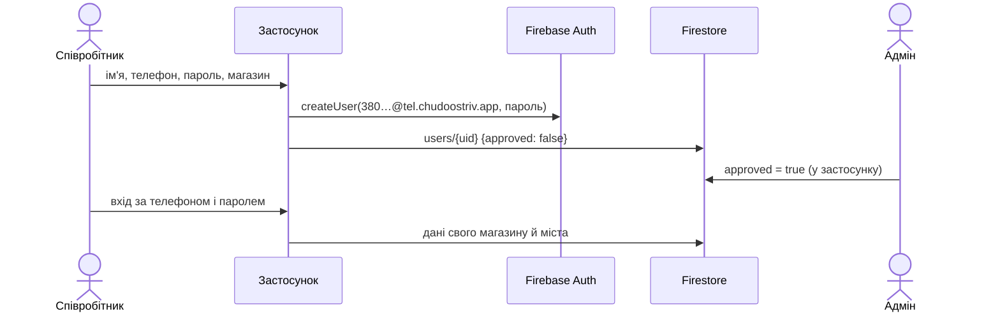

- **Логін.** Firebase тримає пароль лише в парі з email, тому логін — службова адреса з номера телефону.
  Користувач її не бачить, SMS не потрібні.
- **Ролі:** співробітник → адмін магазину (`admin`) → адмін мережі (`superAdmin`); окремо — адмін
  залишків (`stockAdmin`). `superAdmin` і `stockAdmin` ставляться лише в консолі Firebase.
- **«Працювати як у магазині ЧО NN»** — адмін мережі тимчасово бачить застосунок очима будь-якого магазину.

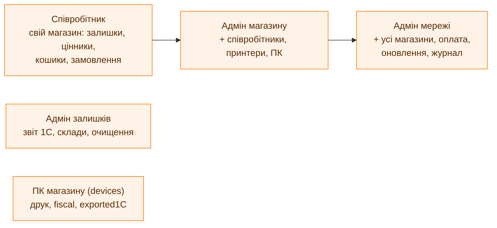

## 10. Залишки мережі

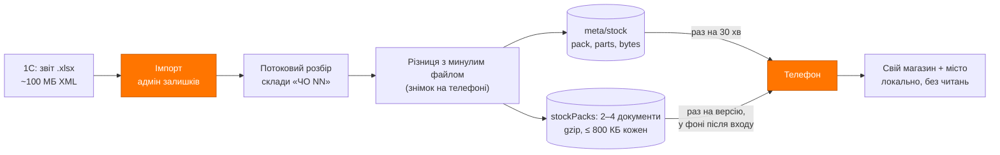

- **Формат звіту:** у колонці B — «назва, КОД, артикул»; під кожним складом — «Штрих код | Конечный остаток».
  Без коду й артикулу — попередження перед завантаженням. Налаштування — [zvit-1c.md](zvit-1c.md).
- **Обсяг:** ~22 000 товарів × 46 магазинів; аркуш читається потоково.
- **Зберігання:** увесь знімок — у 2–4 документах `stockPacks` (замість документа на товар); старі частини видаляються.
  Телефон качає пакет раз на версію (WorkManager після входу: Wi-Fi або пакет < 2 МБ) і шукає локально:
  штрихкод, код 1С, артикул, «що в магазині ЧО NN», «змінені».
- **Старий формат** `stock/{штрихкод}` не читається; адмін залишків видаляє його кнопкою — до 5 000 на добу.
- **Захист:** магазин без товарів у файлі не обнуляється; товарів < 50% від минулого — підтвердження;
  невідомий склад — «Який це магазин?» з підказкою за назвою ТЦ.

## 10a. Термінал і оплата

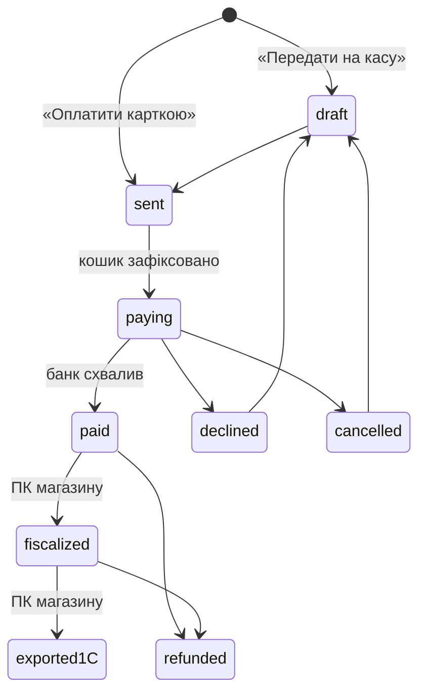

- Кошик — `terminal/Cart.kt`, гроші в копійках (`Long`); кошик зберігається у файлі й переживає перезапуск і оновлення.
- Оплата — `payment/`: `PaymentProvider` (pay, status, refund), `PaymentFlow` (перед pay — status(), відновлення після збою),
  `SaleStates` = `clientStep`/`trustedStep` у правилах. Провайдер вибирається за `shops/{shopId}.payment.provider`;
  фейковий — лише в debug-збірці. Докладно — [oplata.md](oplata.md), формат для 1С — [obmin-prodazhiv-1c.md](obmin-prodazhiv-1c.md).

## 10b. Оновлення

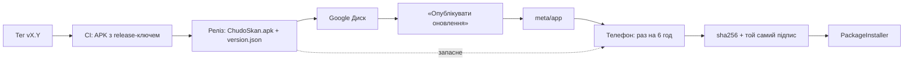

Докладно — [onovlennia.md](onovlennia.md).

## 11. Друк

Продавець нічого не налаштовує: «Цінник» → надруковано.

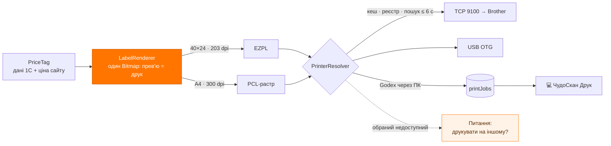

- **Реєстр** `shops/{shopId}/printers/{id}`: id — MAC (SNMP), тому зміна IP не створює дубль.
- **Пошук:** NSD, TCP 9100 по `printerSubnets` і /24 Wi-Fi телефона, SNMP, вебсторінка Godex.
- **Вибір принтера** запам'ятовується окремо для етикеток і A4; якщо обраний не відповідає — питання, а не
  тиха заміна.
- **A4 альбомно:** аркуш малюється 3508×2480 і повертається на 90°; розкладка рахується від друкованої
  області Brother (поле 4,2 мм).
- **EAN-13:** тиха зона 5 модулів, модуль — ціле число точок; тест читає штрихкод зі справжнього Bitmap друку.

## 12. ЧудоСкан Друк

Програма для ПК, до якого кабелем підключено Godex. Без служби Windows, без прав адміністратора і
без ключів сервісного акаунта.

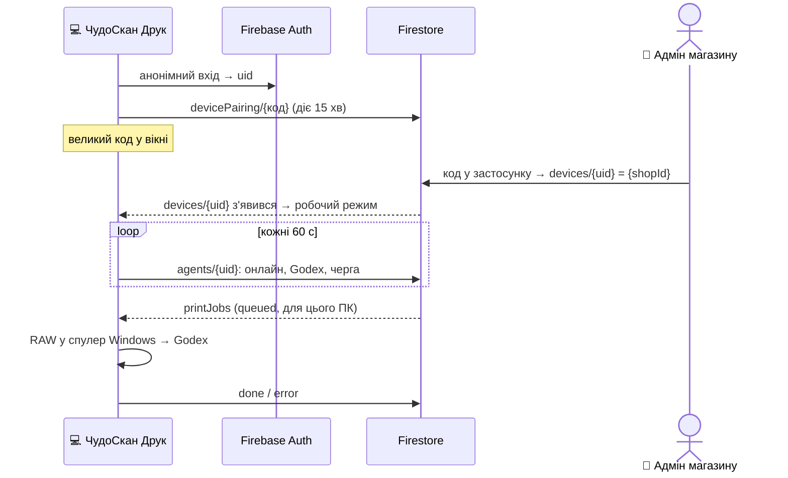

- **Права ПК** — лише його магазин: взяти завдання для себе, змінити їхній статус, писати свій пульс.
  «Відключити» видаляє `devices/{uid}` — доступ закривається одразу.
- **Надійність:** завдання забирається транзакцією; зависле `printing` > 2 хв повертається в чергу один раз;
  `done/error` старші 7 днів видаляються.
- **Вікно:** 🟢 Працює · 🔵 Підключіть комп'ютер · 🔴 Потрібна увага · ⚪ Немає зв'язку; значок біля годинника.
- **Збірка:** `printer.yml` — .NET-тести → установники x64 і x86 (Inno Setup, `PrivilegesRequired=lowest`).

## 13. Збірка і CI

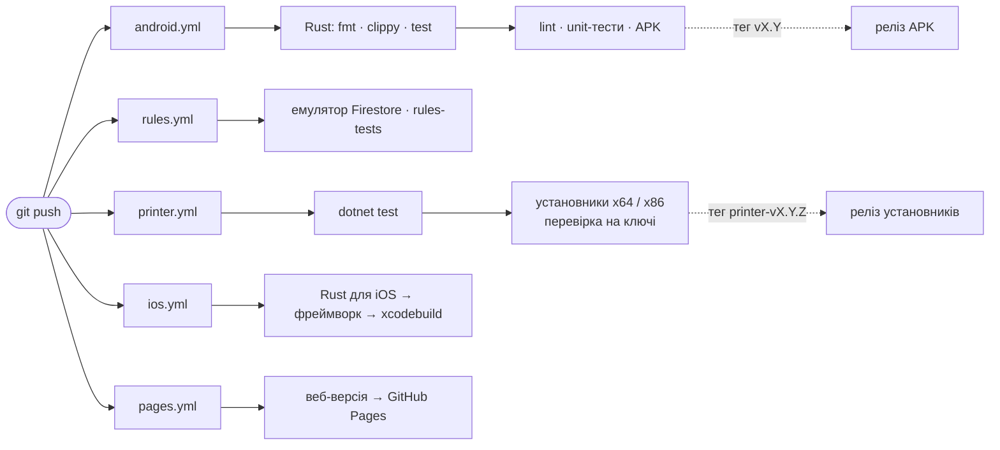

Версії залежностей — в одному каталозі [`gradle/libs.versions.toml`](../gradle/libs.versions.toml).
Lint Android суворий: попередження — це помилки.

## 14. Тести

| Набір | Де | Що перевіряє |
|---|---|---|
| Ядро | `core/src/**`, `core/tests/real_responses.rs` | Штрихкоди, URL, розбір GraphQL, блокування; справжні відповіді сайту |
| Контракт моделей | `shared/src/androidUnitTest/CoreContractTest.kt` | Kotlin-моделі iPhone-мосту ↔ JSON ядра |
| Залишки мережі | `app/src/test/.../data/Network*Test.kt`, `StoreMatcherTest.kt` | Розбір звіту 1С, різниця, захист, підказка магазину |
| Друк | `app/src/test/.../print/*Test.kt` | EAN-13 (ZXing), EZPL/PCL, розкладка аркушів, вибір принтера без тихої заміни |
| Дизайн | `app/src/test/.../design/DesignSnapshots.kt` | Знімки Paparazzi екранів і цінників |
| Правила | `rules-tests/rules.test.js` | Ролі, свій магазин, підключення ПК, залишки мережі — дозволи й відмови |
| ЧудоСкан Друк | `printer/ChudoScan.Print.Tests` | Godex з WMI, дедуплікація, код, завислі завдання, стан |

Якщо сайт змінить розмітку, першими впадуть тести на `fixtures` — раніше, ніж це помітять продавці.

## 15. Рішення

| Рішення | Чому |
|---|---|
| **Rust для спільної логіки** | Ядро з'явилося раніше iPhone-версії й покрите тестами на справжніх відповідях; маленька нативна бібліотека для всіх платформ |
| **Ядро без мережі** | HTTP потребує платформного (cookies, WebView для Cloudflare); так ядро детерміноване |
| **Два мости** | UniFFI зручніший для Android, але не підтримує Kotlin/Native; для iPhone — C + JSON + контрактний тест |
| **Firebase через REST на iPhone і в вебі** | Потрібно кілька викликів — простіше Ktor, ніж нативний SDK з CocoaPods |
| **Вхід за телефоном без SMS** | SMS у Firebase платні; телефон + пароль безкоштовні, а підтвердження адміном закриває доступ стороннім |
| **ПК входить анонімно й підключається кодом** | Жодних ключів сервісного акаунта на комп'ютерах магазинів; права лише свого магазину |
| **Залишки мережі одним звітом 1С і пакетом** | Один файл від адміна замість вивантаження в кожному магазині; 2–4 записи пакета замість 22 000 документів, пошук на телефоні локальний |
| **Оплата через інтерфейс провайдера** | Банк підключається одним класом; ключі банку й ПРРО — лише в застосунку банку та на ПК магазину |
| **Оновлення з Google Диска, запасне — GitHub** | Без Google Play; Диск керує адмін мережі, GitHub — постійні посилання без лімітів API |
| **Ручний DI** | Один контейнер на десяток залежностей зрозуміліший за Hilt/Koin і не сповільнює збірку |

## 16. Обмеження

- Сайт віддає наявність «є / немає»; кількість — лише зі звіту 1С і на момент завантаження.
- Залишки мережі — на момент останнього звіту 1С; без інтернету працює вже завантажений пакет.
- Оплата карткою вимкнена до договору з банком і ПРРО ([oplata.md](oplata.md)).
- UPCitemdb (безкоштовно) — близько 100 запитів на добу; прив'язані штрихкоди ліміт не витрачають.
- iPhone у TestFlight потребує Apple Developer Program; CI до цього готовий.
- Замовлення поки на демо-даних.
