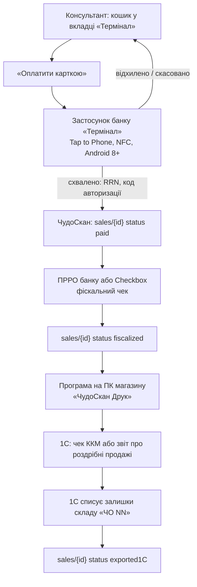

# Обмін продажами з 1С

Специфікація для програміста 1С і для майбутньої оплати карткою в «Терміналі».
Зараз застосунок уміє лише кошик і «Передати на касу» (`sales/{id}` зі статусом `draft`).
Оплати, фіскалізації й передачі в 1С ще **немає**. Цей документ описує, як вони працюватимуть, щоб 1С можна було готувати вже зараз.

Формат одного продажу — [`sale.schema.json`](sale.schema.json) (JSON Schema 2020-12).

## Як це працюватиме



1. Консультант збирає кошик і натискає **«Оплатити карткою»**.
2. ЧудоСкан відкриває застосунок банку «Термінал» (Tap to Phone). Покупець прикладає картку або телефон до NFC продавця.
3. Банк повертає результат. Якщо оплату схвалено, у `sales/{id}` записуються `payment` (RRN, код авторизації, маскована картка) і статус `paid`.
4. Чек фіскалізує ПРРО: програмний РРО банку або Checkbox. Ключі ПРРО є лише на ПК магазину або на сервері, телефон їх не має.
5. Програма на ПК магазину бере продажі свого магазину зі статусом `fiscalized` і передає їх у 1С у форматі нижче.
6. 1С проводить **чек ККМ** (або додає продаж у **звіт про роздрібні продажі** за день) і списує залишки складу магазину.
7. Після підтвердження від 1С програма ставить `exported1C`. Повторно той самий продаж не надсилається.

Статуси й переходи: `draft → sent → paying → paid → fiscalized → exported1C`. Відхилена чи скасована оплата повертає продаж у `draft`.
Докладніше — у `docs/oplata.md` (з'явиться разом із готовністю до оплати).

## Формат продажу

Приклад (знеособлений):

```json
{
  "version": 1,
  "saleId": "8Fq3kM1zXc0YtP2b",
  "shopCode": "22",
  "at": "2026-11-24T14:05:31+02:00",
  "cashier": { "uid": "u-22-0001", "name": "Консультант" },
  "items": [
    { "barcode": "4820000000017", "code1C": "BUK000123", "article": "MB-22", "qty": 2, "priceKop": 24990, "discountKop": 4998, "sumKop": 44982, "manualPrice": false },
    { "barcode": "2000999154010", "code1C": "BOC022446", "article": "", "qty": 1, "priceKop": 12900, "discountKop": 1290, "sumKop": 11610, "manualPrice": true },
    { "barcode": "4820000000024", "code1C": "DPK000777", "article": "", "qty": 1, "priceKop": 8999, "discountKop": 900, "sumKop": 8099, "manualPrice": false }
  ],
  "discountKop": 7188,
  "totalKop": 64691,
  "payment": { "method": "card", "amountKop": 64691, "provider": "privat-nfcpos", "terminalId": "T0000001", "rrn": "432812345678", "authCode": "A1B2C3", "maskedPan": "4149 49** **** 1234", "verified": true },
  "fiscal": { "fiscalNumber": "4000123456", "prro": "bank", "at": "2026-11-24T14:05:40+02:00" }
}
```

| Поле | Що це | У 1С |
|---|---|---|
| `shopCode` | код магазину з «ЧО NN» (`"22"`) | склад і торгова точка чека |
| `items[].code1C` | код номенклатури (`BOC022446`) | товар; немає коду — шукати за `barcode` |
| `items[].barcode` | штрихкод | запасний пошук товару |
| `items[].qty` | кількість, ціле | кількість |
| `items[].priceKop` | ціна за одиницю до знижки, копійки | ціна |
| `items[].discountKop` | частка знижки чека на рядок | сума ручної знижки рядка |
| `items[].sumKop` | `qty × priceKop − discountKop` | сума рядка |
| `discountKop` | знижка на весь чек | — (сума знижок рядків) |
| `totalKop` | до сплати | сума документа |
| `payment.method` | `card` або `cash` | вид оплати: платіжна картка / готівка |
| `payment.rrn` | номер банківської операції | реквізит оплати карткою |
| `payment.authCode`, `maskedPan`, `terminalId` | код авторизації, картка, термінал | реквізити оплати |
| `fiscal.fiscalNumber` | фіскальний номер чека ПРРО | номер чека ККМ |
| `at` | час оплати, ISO 8601 з поясом Києва | дата документа |

### Правила

- **Гроші — цілі копійки.** Ні дробових гривень, ні округлень на боці 1С. 1С ділить на 100 лише для показу.
- **Знижка розкладається по рядках** методом найбільших залишків:
  частка рядка = `discountKop × сума рядка / сума чека`, ціла частина — кожному рядку;
  копійки, що лишилися, — по одній рядкам з найбільшою дробовою частиною (при рівності — вищому рядку).
  Сума знижок рядків завжди дорівнює `discountKop`, а сума `sumKop` — `totalKop`.
- **`saleId` унікальний.** 1С зберігає його в документі (реквізит «Номер замовлення ЧудоСкан»). Повторне надсилання того самого `saleId` нічого не створює і повертає «вже є».
- **Товар без коду 1С** (`code1C` порожній) шукається за штрихкодом. Не знайшли — продаж не проводиться, і 1С повертає помилку з `saleId` і штрихкодом.
- **`manualPrice: true`** — ціну ввів продавець. 1С проводить за цією ціною і може показати такі рядки в окремому звіті для перевірки.
- **Повернення** — окремий документ із посиланням на `saleId` продажу (формат — у `docs/oplata.md`).

### Як передається

Програма на ПК магазину («ЧудоСкан Друк») — довірена сторона: вона має доступ до Firestore і до 1С.
Спосіб передачі обирає програміст 1С:

| Варіант | Як | Коли зручно |
|---|---|---|
| HTTP-сервіс 1С | `POST /hs/chudoskan/sales`, тіло — JSON продажу; відповідь `200 {"status":"ok"}` або `{"status":"exists"}`, помилка — `4xx {"error": "…"}` | 1С опублікована у веб-сервері |
| Папка обміну | файл `sale-<saleId>.json` у спільній папці; 1С забирає регламентним завданням і переносить у `done/` або `error/` | без веб-сервера |

Програма надсилає продажі по одному. Після успіху ставить `exported1C`, після помилки — повторює з паузою і показує помилку адміну магазину.

## Що потрібно від мережі

| Що | Навіщо | Хто |
|---|---|---|
| **Договір еквайрингу Tap to Phone** | приймати картки на телефон без POS-терміналу | керівництво мережі + банк |
| **ПРРО і касири** | фіскальний чек на кожен продаж: ПРРО банку або Checkbox, реєстрація в ДПС, касири з КЕП | бухгалтерія |
| **Програміст 1С** | прийом продажів (HTTP-сервіс або папка), проведення чеків ККМ / звіту про роздрібні продажі, списання залишків | мережа |
| **Телефони з NFC** | Android 8+ з NFC і Google Play Services, без root | магазини |
| **Документація банку** | як викликати застосунок «Термінал» і отримати результат: [app.privatbank.ua/nfcpos](https://app.privatbank.ua/nfcpos) | банк |

## Чого тут немає навмисно

- **Ключів банку й ПРРО.** Вони ніколи не потрапляють у застосунок чи репозиторій, лише на ПК магазину або сервер.
- **Коду оплати.** Він з'явиться після договору з банком: окремий клас провайдера, кошик і правила переробляти не доведеться.
