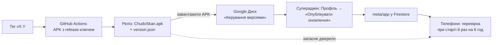

# Оновлення ЧудоСкан і «ЧудоСкан Друк»

Телефони оновлюються самі. Основне джерело — **Google Диск** (`meta/app` у Firestore), запасне — **GitHub Releases**.
Програма для ПК «ЧудоСкан Друк» оновлюється з GitHub.

## Як випустити оновлення застосунку

1. Збільште версію і поставте тег: `git tag -a v3.1 -m "Термінал: оплата карткою"` → `git push origin v3.1`.
2. CI сам:
   - збирає APK з `versionName = 3.1` і `versionCode = 1000 + номер збірки` (кожна збірка більша за попередню);
   - підписує його **тим самим release-ключем** із GitHub Secrets;
   - кладе в реліз `ChudoSkan-3.1.apk` (для сторінки встановлення), `ChudoSkan.apk` і `version.json`.
   Посилання без лімітів GitHub API:
   - `https://github.com/Nikifor3663636/chudoskan/releases/latest/download/version.json`
   - `https://github.com/Nikifor3663636/chudoskan/releases/latest/download/ChudoSkan.apk`
3. **Google Диск.** Завантажте `ChudoSkan.apk` з релізу на Диск через
   **«Керування версіями → Завантажити нову версію»** у вже наявний файл. ID файлу і посилання не змінюються.
   Доступ до файлу — **«Усі, хто має посилання»**.
4. **Опублікувати.** У застосунку суперадмін: **Профіль → «Опублікувати оновлення»** → вставити посилання на файл → **«Перевірити APK»**.
   Застосунок сам:
   - витягує ID з посилання й завантажує APK;
   - читає `versionCode` і `versionName`, рахує sha256;
   - перевіряє, що APK підписано тим самим ключем і що він новіший за опублікований;
   - показує «Опублікувати 3.1?» і після підтвердження записує `meta/app` та рядок у журнал дій.

Телефони отримують оновлення **протягом 6 годин** або одразу після **Профіль → «Версія X.Y · Перевірити оновлення»**.

Якщо `meta/app` порожній, телефони беруть оновлення з GitHub (`version.json`).

### Якщо Диск пише «перевищено ліміт завантажень»

Google Диск обмежує, скільки разів можна завантажити популярний файл за добу.
Тоді у «Опублікувати оновлення» натисніть **«Джерело: Google Диск → перемкнути на GitHub»**: телефони почнуть брати APK з GitHub.
Коли ліміт скинеться, перемкніть назад.

### Release-ключ (один раз)

Оновлення встановлюється лише поверх APK, підписаного **тим самим ключем**. Ключ зберігається тільки в GitHub Secrets і ніколи не потрапляє в репозиторій.

1. Створіть ключ: `keytool -genkeypair -v -keystore release.jks -alias chudoskan -keyalg RSA -keysize 4096 -validity 10000`.
2. У GitHub: **Settings → Secrets and variables → Actions** додайте:
   - `ANDROID_KEYSTORE_BASE64` — вміст `base64 -w0 release.jks`;
   - `ANDROID_KEYSTORE_PASSWORD`, `ANDROID_KEY_ALIAS`, `ANDROID_KEY_PASSWORD`.
3. Збережіть `release.jks` і паролі в надійному місці поза репозиторієм. Якщо ключ загубиться, автооновлення доведеться почати з нуля: на кожному телефоні видалити застосунок і встановити заново.

Без секрету тег `vX.Y` не випустить реліз: CI зупиниться з поясненням.

> **Перехід на release-ключ.** Попередні APK з релізів підписувалися тимчасовим ключем збірки.
> Першу версію з release-ключем на кожен телефон потрібно встановити **вручну один раз**: видалити стару й поставити нову.
> Далі оновлення приходять самі.

## Як зробити оновлення обов'язковим

Старі версії показують повноекранне **«Потрібне оновлення»** з кнопкою «Оновити». Працювати не можна, можна лише вийти з акаунта.

- **Під час публікації:** у «Опублікувати оновлення» поставте галочку **«Обов'язкове»** → `minVersionCode = versionCode`.
- **Без нового релізу:** суперадмін у консолі Firebase змінює `meta/app.minVersionCode` (і за бажанням `meta/app.message` — свій текст).
- **Через GitHub:** слово «обов'язкове» в тексті тегу (`git tag -a v3.1 -m "Обов'язкове: виправлення оплати"`) → `minVersionCode` у `version.json`.

`meta/app` читає будь-який підтверджений співробітник, а пише лише `superAdmin`. Поля обмежені білим списком, правила перевірено тестами.

## Що бачить користувач

| Ситуація | Що на екрані |
|---|---|
| Є нова версія | банер **«Доступне оновлення X.Y — Оновити»** над нижньою панеллю |
| Натиснув «Оновити» | завантаження → перевірка sha256 і підпису → встановлення |
| «Встановлення з цього джерела» вимкнено | підказка з кнопкою **«Відкрити налаштування»** |
| Версія нижча за мінімальну | повноекранне **«Потрібне оновлення»** |
| APK підмінено (інший sha256 або підпис) | файл видаляється, показується помилка, нічого не встановлюється |
| Профіль | **«Версія X.Y · Перевірити оновлення»** |

- **Фонове завантаження** — лише на Wi-Fi або якщо APK менший за 50 МБ.
- **Роботу не перебиває.** Саме оновлення ставиться лише тоді, коли застосунок у фоні, або після натискання «Оновити».
- **Кошик «Термінал»** весь час зберігається у файлі, тож оновлення й перезапуск його не гублять.

## Обмеження Android

- **Перше оновлення** (або перше після перевстановлення) — з системним діалогом «Встановити».
- **Наступні** на Android 12+ ставляться **без діалогу**, якщо попередню версію встановив сам застосунок і прошивка це дозволяє. Інакше — один діалог.
- **Повністю без участі людини** оновлення ставлять лише Google Play або система керування пристроями (MDM).
- Потрібен дозвіл **«Встановлення з цього джерела»** для ЧудоСкан. Застосунок сам відкриває потрібне налаштування.

## «ЧудоСкан Друк» (ПК магазину)

1. Тег `printer-vX.Y.Z` → CI збирає інсталятори x64/x86 і кладе їх у реліз `printer-vX.Y.Z`.
2. Те саме CI копіює в реліз **`printer-latest`** зі стабільними іменами: `ChudoScanPrint-x64.exe`, `ChudoScanPrint-x86.exe` і `printer-version.json` (версія, sha256).
3. Програма при старті (через хвилину) і раз на 6 год читає
   `https://github.com/Nikifor3663636/chudoskan/releases/download/printer-latest/printer-version.json`.
   Якщо версія новіша, програма:
   - завантажує інсталятор;
   - перевіряє sha256 і цифровий підпис, якщо файл підписано;
   - запускає інсталятор окремим процесом і закривається.
4. Інсталятор тихо ставить нову версію і запускає її **в треї**.
   Завдання друку в цей час лишаються у Firestore зі статусом `queued`, і нова версія їх друкує.

Журнал оновлень — у журналі програми (`chudoscan.log`): «Оновлення 1.2.0 → 1.3.0: запускаю інсталятор».
