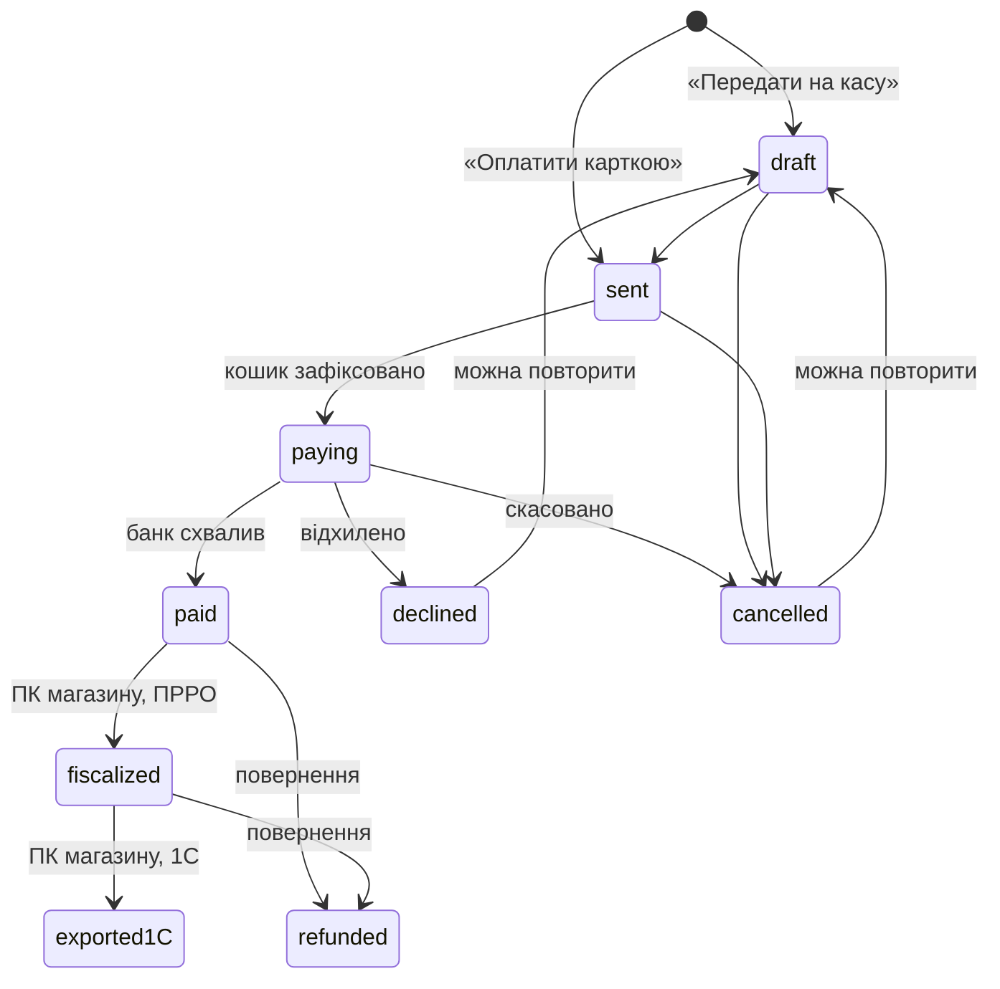

# Оплата карткою: як усе влаштовано і як підключити банк

Поки договору з банком немає, кнопка «Оплатити карткою» у вкладці «Термінал» неактивна.
Усе інше вже готове: кошик, стани продажу, правила Firestore, журнал, відновлення після збою, повернення.
Коли з'являться договір і ПРРО, потрібно лише:

1. написати **один клас провайдера**;
2. **зареєструвати** його;
3. **увімкнути** в `shops/{shopId}.payment`.

Кошик, правила й обмін з 1С переробляти не доведеться.

## Як додати нового провайдера

### 1. Клас

`app/src/main/java/ua/chudo/scanner/payment/<Банк>Provider.kt`:

```kotlin
class PrivatNfcPosProvider(private val context: Context) : PaymentProvider {
    override val id = "privat-nfcpos"

    // Викликає застосунок банку «Термінал» (Tap to Phone) з номером замовлення = saleId і сумою в копійках.
    override suspend fun pay(saleId: String, amountKop: Long): PaymentResult = TODO("за документацією банку")

    // Питає банк, чим закінчилася операція saleId: Approved / Declined / Cancelled / Unknown.
    override suspend fun status(saleId: String): PaymentResult = TODO()

    override suspend fun refund(saleId: String, rrn: String, amountKop: Long): PaymentResult = TODO()
}
```

Правила для провайдера:

- **Жодних ключів у класі.** Ключі й сертифікати еквайрингу зберігає застосунок банку, а не ЧудоСкан.
- `pay()` повертає `Unknown`, якщо банк не відповів або відповідь загубилася. Не можна повертати `Declined`, коли невідомо, чи списано гроші.
- `status()` має працювати для будь-якого `saleId`, навіть якщо `pay()` для нього ще не викликали (тоді `Cancelled`).

### 2. Реєстрація

`app/src/release/java/ua/chudo/scanner/payment/BuildProviders.kt` (і так само в `src/debug/…`):

```kotlin
object BuildProviders {
    fun all(): Map<String, PaymentProvider> = mapOf("privat-nfcpos" to PrivatNfcPosProvider(app))
}
```

Фейковий провайдер `fake` (схвалено / відхилено / таймаут / невідомо) є **лише в debug-збірці**.
Тест `ReleaseProvidersTest` (`./gradlew :app:testReleaseUnitTest`) перевіряє, що в release його немає.

### 3. Увімкнути в магазині

Адмін мережі в консолі Firebase: `shops/{shopId}` → поле `payment` (map):

| Поле | Значення |
|---|---|
| `provider` | `"privat-nfcpos"`, `"none"` (вимкнено) або `"fake"` (лише debug-збірка) |
| `terminalId` | ідентифікатор термінала з договору (необов'язково) |

У цьому полі **лише ідентифікатори**. Правила дозволяють тільки `provider` і `terminalId` у вигляді латинських літер, цифр і дефісів. Ключ туди не запишеш.
Писати `payment` може лише адмін мережі (`superAdmin`).

## Стани продажу



- **Лише вперед.** Назад або через крок — не можна. Те саме перевіряють `SaleStates.kt` і `firestore.rules` (`clientStep`, `trustedStep`).
- **Перед `pay()`** ставиться `paying`. З цієї миті склад кошика й сума зафіксовані: застосунок не дає їх змінити, а правила не дозволяють змінити `items` і `total`.
- **Ідемпотентність.** `saleId` — номер замовлення для банку. Перед кожним `pay()` застосунок викликає `status()`. Якщо банк уже провів цей `saleId`, друге списання не відбувається, продаж просто стає `paid`.
- **Після збою чи перезапуску** продажі в `paying` перевіряються автоматично через `status()`. Якщо відповідь `Unknown`, продавець бачить «Перевірте оплату в застосунку банку», а повторного списання немає.
- **Повернення** — окремий документ `refunds/{id}` з посиланням на `saleId`. Продаж стає `refunded`. Сума повернення не більша за суму продажу.
- **Журнал.** Кожна зміна статусу записується в `sales/{id}/log`: хто, коли, з якого стану в який. Правила приймають запис журналу лише разом зі справжньою зміною статусу.

## Хто що пише

| Поле `sales/{id}` | Хто пише |
|---|---|
| `items`, `discount`, `total`, `code` | телефон під час створення; змінювати можна лише в `draft` |
| `status` | телефон — за `clientStep`; ПК магазину — `fiscalized`, `exported1C` |
| `payment {provider, rrn, authCode, maskedPan, amountKop, at}` | телефон, лише під час переходу `paying → paid`; `amountKop` = `total` |
| `fiscal {fiscalNumber, url, at, prro}` | **лише довірена сторона** (ПК магазину / сервер) |
| `exported1C`, `verified` | **лише довірена сторона**. Вона звіряє оплату з банком і ставить `verified: true` |

Довірена сторона — це ПК магазину, підключений адміном (`devices/{uid}.shopId`), і лише для свого магазину.

## Що де зберігається

| Де | Що |
|---|---|
| **Телефон** | лише кошик у пам'яті й `saleId` поточної оплати. Ключів банку й ПРРО немає |
| **Застосунок банку** | ключі еквайрингу, сертифікати, NFC-обмін з карткою |
| **ПК магазину** («ЧудоСкан Друк») | ключі ПРРО (`IFiscalizer`), доступ до 1С (`ISalesExporter`), журнал переданих `saleId` |
| **Firestore** | `sales/{id}`, `sales/{id}/log`, `refunds/{id}`, `shops/{shopId}.payment` — лише ідентифікатори операцій |

На ПК магазину вже є інтерфейси й заглушки (`printer/ChudoScan.Print.Core/Sales.cs`):

- `ISalesExporter` / `SalesExporter` — бере продажі свого магазину зі статусом `fiscalized`, передає в 1С і ставить `exported1C`. Ідемпотентний за `saleId`.
- `IFiscalizer` / `NotConfiguredFiscalizer` — поки що відповідає «Фіскалізацію не налаштовано».

Формат для 1С описано в [obmin-prodazhiv-1c.md](obmin-prodazhiv-1c.md) і [sale.schema.json](sale.schema.json).

## Ліміти Firestore

Одна оплата коштує приблизно 6–8 записів:

- створення продажу;
- переходи `sent → paying → paid`, кожен разом із записом у журнал;
- `fiscalized` і `exported1C` від ПК магазину.

Ще потрібно 3–4 читання. За безкоштовного ліміту 20 000 записів на добу це близько 2 500 оплат на день на всю мережу.

## Чек-лист запуску з банком

- [ ] Договір еквайрингу Tap to Phone; ідентифікатор термінала для кожного магазину.
- [ ] Документація банку для виклику застосунку «Термінал» (наприклад, [app.privatbank.ua/nfcpos](https://app.privatbank.ua/nfcpos)).
- [ ] Клас провайдера + тести з фейковим застосунком банку: схвалено, відхилено, таймаут, `Unknown` → `status()`.
- [ ] Реєстрація в `BuildProviders` (release і debug).
- [ ] ПРРО: банку або Checkbox; касири з КЕП; ключі лише на ПК магазину. Реалізація `IFiscalizer`.
- [ ] Програміст 1С: прийом продажів (HTTP-сервіс або папка), реалізація `IOneCClient`.
- [ ] Пілот в одному магазині: `shops/{shopId}.payment = {provider: "<id>", terminalId: "…"}`.
- [ ] Перевірити на пілоті: оплата, відхилення, вимкнений інтернет під час оплати (→ `Unknown` → після перезапуску правильний стан), повернення, чек, продаж у 1С.
- [ ] Увімкнути в інших магазинах.
