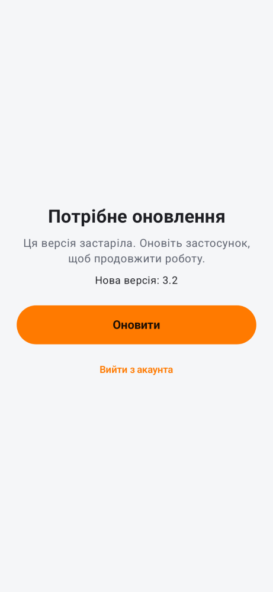

# Посібник адміна

| Роль | Хто ставить | Що робить |
|---|---|---|
| Адмін магазину (`admin`) | адмін мережі в застосунку | співробітники, принтери й ПК свого магазину |
| Адмін залишків (`stockAdmin`) | лише консоль Firebase | щоденний звіт 1С, прив'язка складів, очищення старих залишків |
| Адмін мережі (`superAdmin`) | лише консоль Firebase | усе для всіх магазинів, оновлення, оплата, журнал дій |

## Співробітники

1. Новий співробітник реєструється сам і чекає підтвердження.
2. **Профіль → «Мій магазин»** (адмін магазину) або **«Адміністрування мережі» → «Співробітники»** (адмін мережі).
3. **«Підтвердити»** або **«Відхилити»**. Кнопка **«Зробити адміном»** робить співробітника адміном свого магазину.
4. Усі дії записуються в журнал. Адмін мережі бачить його в **«Дії адмінів»**.

Адмін мережі може **«Працювати тут»** у будь-якому магазині: застосунок показує все очима цього магазину до виходу.

## Залишки з 1С (адмін залишків)

Налаштування звіту й щоденний порядок — **[zvit-1c.md](zvit-1c.md)**. Коротко:

1. 1С → «Восстановить значения» → «Остатки на сегодня» → **«Сформировать»** → зберегти `.xlsx`.
2. ЧудоСкан → **Профіль → «Залишки мережі»** → **«Вибрати файл xlsx»**.
3. Застосунок розбирає файл і показує прогрес. Перед записом він перепитає, якщо:
   - у звіті немає коду 1С і артикулу;
   - товарів менше половини від минулого разу.
4. **Новий склад.** Застосунок спитає **«Який це магазин?»** з підказкою за назвою ТЦ і містом. Більшість складів прив'язується сама.
5. **«Готово»**: скільки магазинів, товарів, змінено й видалено. Телефони побачать нові залишки протягом 30 хвилин.

**Старі залишки (stock/…)** — документи старого формату. Кнопка **«Видалити старі залишки (stock/…)»** видаляє їх пачками, **до 5 000 на добу**.
Поруч видно, скільки лишилося. Ліміт вичерпано — продовжте завтра.

## Принтери і ПК магазину (адмін магазину)

- **Профіль → «Принтери» → «Знайти принтери»**: телефон сам шукає Brother і Godex у мережі магазину.
- **Godex через ПК:**
  1. Встановіть «ЧудоСкан Друк» на комп'ютер з Godex (інсталятор з релізу, без прав адміністратора).
  2. Програма покаже 6-значний код.
  3. У застосунку: **«Підключити комп'ютер»** → ввести код → **«Підключити»**.
  4. ПК отримує права лише свого магазину. **«Відключити»** одразу закриває доступ.
- Програма для ПК **оновлюється сама** і не втрачає чергу друку.

## Оновлення застосунку (адмін мережі)

Докладно — **[onovlennia.md](onovlennia.md)**.

1. Розробник ставить тег `vX.Y` → у релізі GitHub з'являється `ChudoSkan.apk`.
2. Завантажте цей APK на Google Диск через **«Керування версіями → Завантажити нову версію»** (посилання не змінюється).
   Доступ — «Усі, хто має посилання».
3. **Профіль → «Опублікувати оновлення»** → вставити посилання → **«Перевірити APK»** → **«Опублікувати X.Y?»**.
   - **«Обов'язкове»** — старіші версії побачать «Потрібне оновлення».
   - Застосунок відхилить APK з іншим підписом або не новішою версією й пояснить, чому.
4. Диск пише «перевищено ліміт завантажень» — **«Джерело: … → перемкнути на GitHub»**.

## Оплата карткою (адмін мережі)

Поки договору з банком немає, у `shops/{shopId}.payment` стоїть `provider: "none"`, і кнопка неактивна.
Як підключити банк і ПРРО — **[oplata.md](oplata.md)**, обмін продажами з 1С — **[obmin-prodazhiv-1c.md](obmin-prodazhiv-1c.md)**.

## Консоль Firebase (один раз)

- **Authentication → Sign-in method:** Email/Password (вхід за телефоном) і Anonymous (ПК магазину).
- Адмін мережі: `users/<uid>` → `superAdmin = true`, `approved = true`. Адмін залишків — `stockAdmin = true`.
- Після оновлення правил: `firebase deploy --only firestore:rules`.
