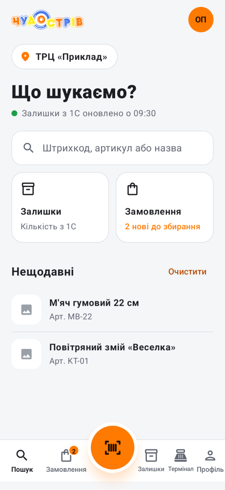
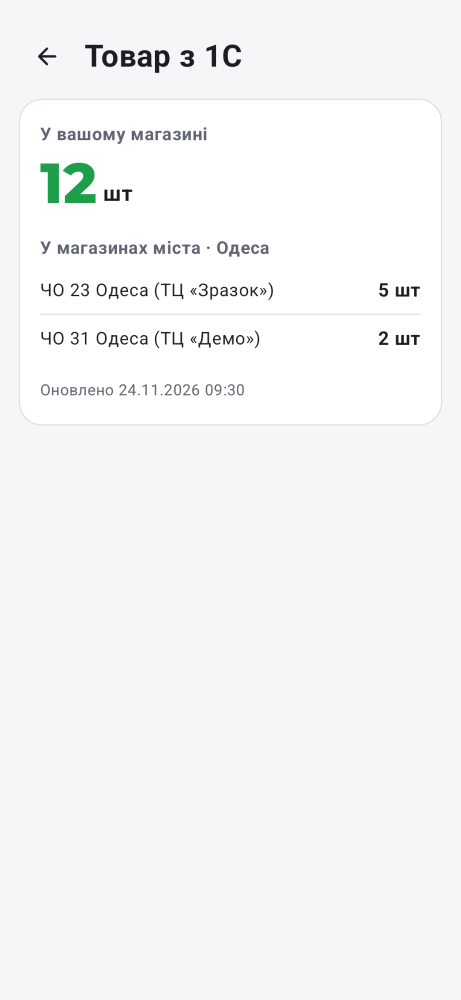
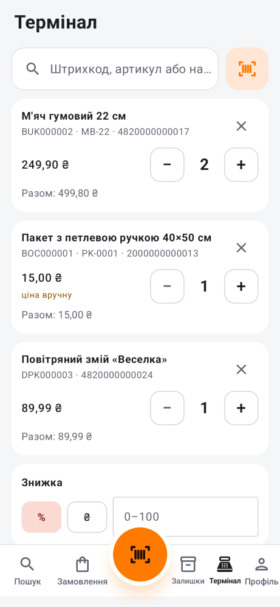
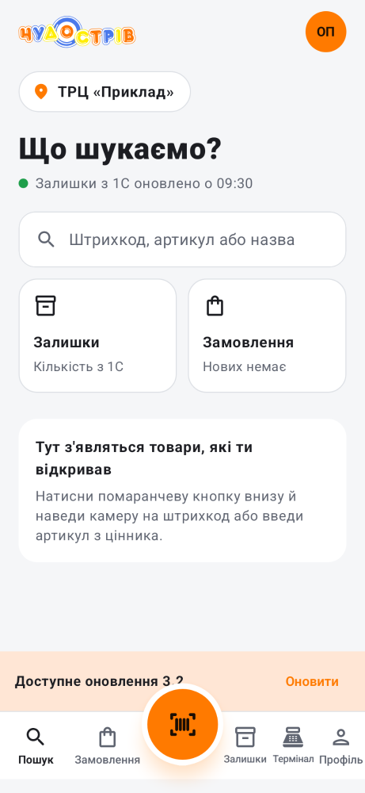

# Посібник консультанта

П'ять кроків, якими користуються щодня: **скан → товар → залишки → цінник → термінал**.
На знімках вигадані товари й магазини.

## 0. Вхід

1. Встановіть ЧудоСкан за посиланням від адміна. Далі застосунок оновлюється сам.
2. **Реєстрація**: ім'я, телефон, пароль, місто й магазин.
3. Зачекайте, поки адмін магазину вас **підтвердить**, після цього увійдіть телефоном і паролем.

## 1. Скан

- Велика помаранчева кнопка внизу по центру — **сканер**. Наведіть камеру на штрихкод.
- Або введіть у поле **«Штрихкод, артикул або назва»**: можна штрихкод, артикул, код 1С (`BOC000001`) чи назву.
- Під заголовком видно, коли оновлено залишки: **«Залишки з 1С оновлено о 09:30»**.
- **«Нещодавні»** — останні знайдені товари; натисніть, щоб відкрити знову.

 

## 2. Товар

- Якщо товар є на сайті, відкривається **картка як на сайті**: фото, ціна, стара ціна, опис.
- Якщо товар є лише в 1С, відкривається картка **«Товар з 1С»**: назва, код, артикул і залишки.
- Кілька схожих товарів — **«Обери товар»**.
- Якщо застосунок знайшов товар через відкриту базу штрихкодів, він спитає **«Це той товар?»**.
  Натисніть **«Запам'ятати»**, і наступного разу цей штрихкод відкриється одразу.

## 3. Залишки

- **«У вашому магазині: N шт»** — кількість з останнього звіту 1С.
- **«У магазинах міста»** — де ще є товар, найбільше зверху.
- Унизу — коли оновлено залишки. Звіт 1С завантажують щодня.
- Повторний скан того самого товару — миттєвий, без інтернету.
- Вкладка **«Залишки»** внизу: пошук по залишках і підпис **«Залишки на ДД.ММ, ГГ:ХХ»**.

 

## 4. Цінник

- У картці товару — **«Друкувати цінник»**: вибрати формат і принтер, якщо їх кілька.
  - Brother друкує A4 по Wi-Fi магазину.
  - Godex друкує етикетки через ПК магазину («ЧудоСкан Друк»).
- **Кілька цінників одразу.** «Залишки» → **«Додати до цінників»** у кожного товару → **«Цінники для вибраних»**.
- **Нові ціни після завантаження 1С.** **«Змінені з минулого завантаження»** додає всі змінені товари свого магазину.
- Немає ціни на сайті — цінник не друкується, застосунок про це скаже.
- Принтер не відповідає — застосунок **спитає**, а не надрукує мовчки на іншому.

## 5. Термінал

1. Вкладка **«Термінал»** → скануйте товари або введіть штрихкод чи артикул.
2. Однаковий товар додається кількістю. Кількість змінюйте кнопками **− / +**, а **×** видаляє товар.
3. Якщо ціни на сайті немає, застосунок попросить **ввести ціну з цінника**. Біля такого товару буде позначка **«ціна вручну»**.
4. **Знижка**: `%` або `₴`.
5. **Готівка.** Введіть, скільки дав покупець, у поле **«Отримано»** — застосунок покаже **«Решта»**.
6. **«Передати на касу»** — на екрані QR і **код кошика** з 6 символів; каса відкриває кошик за ним.
7. Кнопка **«Оплатити карткою»** стане активною після підключення банку.
   Якщо оплата зависла, кнопка зміниться на **«Перевірити оплату»**: повторного списання не буде.

Кошик не губиться, навіть якщо застосунок закрився чи оновився.

 

## Оновлення

- Внизу з'являється **«Доступне оновлення X.Y — Оновити»** — натисніть, коли зручно.
- Перший раз Android попросить дозволити **«Встановлення з цього джерела»**: застосунок сам відкриє потрібне налаштування.
- **«Потрібне оновлення»** на весь екран означає, що працювати можна лише після оновлення.
- **Профіль → «Версія X.Y · Перевірити оновлення»** перевіряє оновлення одразу.

 

## Якщо щось не так

| Що бачу | Що робити |
|---|---|
| «Немає у вивантаженні 1С» | Товар не завантажено зі звітом — спробуйте **«Шукати на сайті»** |
| Залишків мережі немає | Сьогоднішній звіт ще не завантажили — скажіть адміну залишків |
| Цінник не друкується | Перевірте Wi-Fi (Brother) або чи ввімкнено ПК з «ЧудоСкан Друк» (Godex) |
| «Перевірте оплату в застосунку банку» | Відкрийте застосунок банку й подивіться, чи пройшла оплата; потім **«Перевірити оплату»** |
